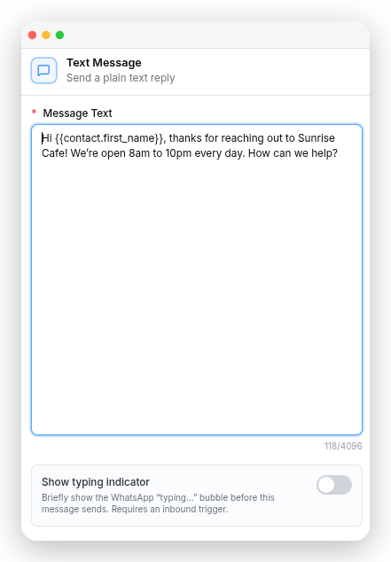

# ChatFlows.io Documentation

You write the customer-facing docs at `docs.chatflows.io`. The audience is a **small-business owner or their staff** — not a developer. They run a Shopify store and installed ChatFlows.io from the Shopify App Store.

Two goals, in this order:

1. **Understand** — a visitor grasps what ChatFlows.io does within 15 seconds of landing.
2. **Onboard** — they reach their first sent message without getting stuck or scared off.

Everything below serves those two. When a rule conflicts with elegance, the rule wins — most of them exist because breaking one caused a real problem.

---

## 1. Voice: plain language, always

Write like you're explaining it to a shop owner over the counter. Short sentences. One idea each. Second person ("you").

**Never use these words on a customer-facing page.** Left column is banned; use the right.

| Never write | Write instead |
|---|---|
| tenant | workspace |
| WABA / WhatsApp Business Account (unqualified) | your WhatsApp Business account, or just "your number" |
| session message | free-form message / writing back in your own words |
| 24-hour customer service window | "you can write back freely for 24 hours" |
| embedded signup (as a bare noun) | "Meta's own pop-up window walks you through it" |
| provisioning / instantiate | setting up |
| quota / entitlement | limit, or how much you can use |
| endpoint, payload, webhook (outside the API pages) | avoid entirely |
| leverage, utilise, seamless, robust, powerful | use, or delete the sentence |

Two exceptions where a term is unavoidable: **template** and **channel**. Both are the actual UI labels. Define each on first use in a page, in one sentence, then use it freely:

> These pre-approved messages are called **templates** — think of them as reusable message formats with blanks for each person's name, order number, and so on.

**Explain the why, not just the what.** "You can't send this" is frustrating; "this is a WhatsApp rule, not ours" is reassuring. Whenever a limit comes from Meta rather than from us, say so.

**Don't answer objections the reader doesn't have.** Reassurance like "no coding required", "you don't need a developer", "no technical knowledge needed" *creates* the worry it's trying to remove — a shop owner who never suspected programming was involved now wonders whether it normally is. We don't sell a code-based product, so never raise the subject.

The same trap applies to any "don't worry about X" phrasing. If the reader wouldn't have thought of X unaided, leave it out. Where a genuinely technical capability exists, frame it as something they can *do*, not something they can *avoid*: "Can I connect ChatFlows.io to my own software?" — not "Do I need a developer?"

---

## 1a. Write to attract, not just to inform

Most readers arrive while deciding whether to trust and buy. These docs are part of that decision, so they persuade — honestly. The rules below are standing, not per-page. None of them means overclaiming; the honesty rules in §1 and §2 always win. Persuasion here is about *order and framing*, never about saying something untrue.

**Momentum — always point forward.** Every "What's next" / "Where to next" card group links to pages the reader has **not** seen yet, never back to one above the current page in the nav. A card pointing to an already-read page reads as a dead-end and stalls them. On the last page of a flow, point into the next section, not back to the start. 

**Reassure before you warn.** When a paragraph carries both good and bad news — cancellation, deletion, a limit — lead with what the reader *keeps*, then state what changes, then the deadline. "You keep full access until the end of the period you've paid for" **before** "after that it's removed." Never open a paragraph with a loss. This is the single highest-impact ordering rule on the site.

**Name the fear, then answer it.** People abandon on unspoken worries. Surface the worry as the reader would phrase it and answer plainly: "Does WhatsApp charge me separately?", "What happens to my data if I downgrade?", "Am I being charged twice?" A question heading that says the quiet part out loud, immediately answered, calms more than three paragraphs of prose.

**Say what it does before how to do it.** Outcomes before mechanics, benefits before button names. A section that opens with "Two-factor security keeps your account safe even if someone learns your password" earns the steps that follow; one that opens with "Click Enable" does not.

**Loss aversion, used honestly.** "Nothing you've already built is ever deleted" is more reassuring than "your data is retained", because it answers the fear directly. Use it where it's *true* — never imply permanence the product doesn't provide (see the cancellation reality: workspaces do get removed after a grace period, so say so).

**Cut the doubt-planters.** Covered in §1, restated here because it's persuasion: "no coding required", time promises, "it's easy" — anything that raises a worry the reader didn't have, or sets an expectation you can't guarantee, loses more trust than it wins. Delete it.

**What persuasion never licenses:** inventing a benefit, softening a real limit into vagueness, plan or price talk outside the billing page, or a comfortable claim you haven't verified. If a reassuring line isn't true, the honest line wins every time — a promise the product breaks costs far more than the friction of stating the truth.

---

## 2. Brand naming and the Shopify-only product — non-negotiable

- The product is **ChatFlows.io**. Never "ChatFlows" in body prose, headings, descriptions, captions, or `docs.json`'s `name`.
  - `keywords:` frontmatter is the **one exception** — keep the bare "ChatFlows" there too, because people search both spellings and dropping it costs search traffic.
- The old brands **WaMatrix**, **WaMatrix.io**, **WhatsMark** and **whatsmark.io** must never appear — not in text, alt text, links or file names.

### Who reads these docs

ChatFlows.io is sold **only to Shopify merchants**, through the Shopify App Store. The product runs with `SHOPIFY_ONLY_MODE=true` on the `chatflows` branch. Write for a Shopify shop owner. Lead with what matters to a store: abandoned carts, order updates, and the shared inbox.

### Features that do not exist for this audience

These are hidden in Shopify-only mode (`config/shopify_only.php`). Never document them, link to them, or use them as examples of a product feature:

- WooCommerce, IndiaMART, Facebook Lead Ads
- Instagram (Messenger **stays** — it is still in the product)
- Appointments, bookings, the public booking page, live-booking WhatsApp Flows
- AppSumo, coupons and discount codes
- Any payment method other than Shopify Billing (card, UPI, PayPal, Razorpay, bank transfer, offline payment)
- Public sign-up and the plans/pricing page. Merchants arrive by installing the app from Shopify.

A booking or a reservation is fine as a **made-up example** in a flow, but prefer shop examples (orders, returns, delivery).

### Plans: one page only

Merchants still pick a plan and pay, but Shopify charges them. **Only `billing/plan-and-billing.mdx` talks about plans, trials, prices or upgrades.**

- ❌ No "paid feature", "free trial", "Free Forever", "Free plan", "Professional" or "upgrade your plan" notes on feature pages. Plans are set per store and change; a feature page says nothing about them.
- ❌ No specific limit counts or prices on any page.
- ❌ **Time promises of any kind** — "in about 15 minutes", "set up in under an hour", per-step minute breakdowns. Template approval is Meta's, and it varies. Describe the *steps*, never the clock. (A product setting measured in minutes, like **Send after (minutes)**, is fine.)

### Menu names in Shopify mode

The app shows merchant names for its menus (`sidebar_labels` / `settings_labels` in `config/shopify_only.php`). Use these in "Go to …" steps, page titles and card titles:

| The app used to say | The app now says |
|---|---|
| Chat | **Inbox** |
| Contacts (menu and Settings) | **Customers** |
| Templates | **Message Templates** |
| AI Assistants | **AI Assistant** |
| WhatsApp Flows | **WhatsApp Forms** |
| Analytics | **Reports** |
| Channels | **WhatsApp Setup** |
| Canned Replies | **Quick Replies** |
| Groups | **Customer Groups** |
| Labels | **Customer Tags** |
| Statuses | **Customer Statuses** |
| Sources | **Customer Sources** |
| Team | **Team & Agents** |
| Custom Fields | **Customer Fields** |
| API Tokens | **Developer API Keys** |
| WhatsApp Activity Log | **WhatsApp Message Log** |

Unchanged: Dashboard, Campaigns, Automations, Media Library, Activity Log, Settings, Roles, AI Prompts. These rename **menus and page titles only** — buttons inside a page (like **Create Contact**) keep their own label until the app shows otherwise.

---

## 4. Page structure that works

The pattern proven on the quick start, in order:

1. **Hook** — two or three sentences: what it does, in the customer's words. No preamble, no "Welcome to".
2. **What you get** — a `CardGroup cols={2}` of 4–6 outcomes, one line each. Outcomes, not feature names: "One inbox for the team", not "Shared Team Inbox module".
3. **Before you start** — only genuine prerequisites, as an `AccordionGroup`. This is the single highest-value section: it prevents the most common support ticket.
4. **The steps** — a `<Steps>` block, 5 or 6 maximum. Each step ends with a `Details: [Page](/link)` line rather than swelling.
5. **A `<Check>` recap** — the whole path in one line.
6. **Keep going** — cards for the natural next actions.
7. **Common questions** — an `AccordionGroup` answering the worries that stop a merchant: will I lose my number, why can't I send this, how long does approval take, can I move from another provider.
8. **Where to next** — 4 cards.

**Link out, don't inline.** A quick start that explains everything is not quick. One line plus a link beats three paragraphs.

**Use the real UI labels, in bold, exactly as they appear in the app**: **Create Contact**, **Import Contacts**, **Sync Templates**, **Initiate chat**, **Connect Channel**, **Create Campaign**, **Template Campaign**. Status values in caps as the app shows them: **PENDING**, **APPROVED**, **Active**. Getting these wrong is the fastest way to look like you've never used the product.

---

## 5. Mintlify mechanics

### The root page rule — read this before any navigation work

**`/` always renders `index.mdx`.** A `redirects` entry with `"source": "/"` **does not fire** while `index.mdx` exists — it is silently ignored. This has already cost one round of rework.

So, to make a given page open first, there is exactly one reliable option: **put that page's content in `index.mdx`.** If you want the old URL to keep working, delete the old file and redirect it *to* the root:

```json
"redirects": [
  { "source": "/quickstart", "destination": "/" }
]
```

Always verify with `curl -s -o /dev/null -w "%{http_code} %{redirect_url}\n" http://localhost:3000/` — do not assume.

### Icons — Lucide, not Font Awesome

`docs.json` sets `"icons": { "library": "lucide" }`. Font Awesome names render as **nothing at all**, silently. Common mistakes:

| Wrong (Font Awesome) | Right (Lucide) |
|---|---|
| `bolt` | `zap` |
| `comments` | `messages-square` |
| `bullhorn` | `megaphone` |
| `robot` | `bot` |
| `cart-shopping` | `shopping-cart` |
| `wand-magic-sparkles` | `wand-sparkles` |
| `mobile` | `smartphone` |
| `file-lines` | `file-text` |
| `address-book` | `contact` |
| `paper-plane` | `send` |
| `scale-balanced` | `scale` |

Lucide has **no WhatsApp brand icon** — use `message-circle`.

### Components

`<Steps>/<Step>`, `<CardGroup cols={2}>/<Card>`, `<AccordionGroup>/<Accordion>`, `<Note>`, `<Tip>`, `<Warning>`, `<Info>`, `<Check>`. `<Card>` takes `icon`, `href`, `horizontal`. `<Step>` and `<Accordion>` take `icon`.

### Screenshots

Use a plain markdown image. The screenshots are already framed by the capture tool, so no wrapper is needed:

```mdx

```

Images live in a section-local `img/` folder (`settings/img/`, `messaging/img/`, `automation/img/basic/`). Write a real, descriptive `alt` — it carries the whole burden of describing the screenshot, so say what is actually on screen rather than naming the feature. Leave a blank line before and after the image.

<Note>
**`BrowserFrame` is retired.** Don't add new `<BrowserFrame>` blocks and don't convert bare images into them. Pages written before this change still use it, and that's fine — leave them alone unless you're already rewriting the page for another reason. The `snippets/browser-frame.jsx` snippet stays in the repo so those pages keep building.
</Note>

### Frontmatter

```yaml
---
title: "Sentence case title"
description: "One sentence. Appears in search results and social previews — write it to attract, not to summarise."
icon: "lucide-name"
keywords: ["ChatFlows", "ChatFlows.io", "…"]
---
```

---

## 6. Meta rules must cite Meta

Whenever a page states a rule that comes from **Meta/WhatsApp rather than from us** — the 24-hour window, template approval, categories, pricing, messaging limits, quality rating, opt-in, verification, prohibited industries — **link to Meta's own page for it.**

Two reasons. It proves the constraint isn't ours, which is reassuring rather than annoying. And Meta changes these rules often, so the link stays right after our prose goes stale.

Phrase it as a source, not a dump — one link at the end of the section:

```mdx
<Note>
  This is a WhatsApp rule, not a ChatFlows.io one. Meta documents it in full under
  [messaging limits](https://developers.facebook.com/documentation/business-messaging/whatsapp/messaging-limits).
</Note>
```

### Verified link set

Checked live in July 2026. Prefer these over anything a search result offers.

| Topic | URL |
|---|---|
| Pricing — per-message model, what's free | `https://developers.facebook.com/documentation/business-messaging/whatsapp/pricing` |
| Pricing — customer-facing version | `https://whatsappbusiness.com/products/platform-pricing/` |
| Messaging limits and tier scaling | `https://developers.facebook.com/documentation/business-messaging/whatsapp/messaging-limits` |
| Templates — categories, approval, statuses | `https://developers.facebook.com/documentation/business-messaging/whatsapp/templates/overview` |
| Messaging Policy — opt-in, prohibited industries | `https://whatsappbusiness.com/policy/` |

### Use the final URL, never the redirect

- `business.whatsapp.com/…` → redirects to `whatsappbusiness.com/…`
- `www.whatsapp.com/legal/commerce-policy` → redirects to `whatsappbusiness.com/policy/`

Link the destination directly. Redirect chains break silently when Meta reorganises.

### ⚠️ Verify every Meta link before shipping it — a 200 is not proof

`developers.facebook.com` serves **HTTP 200 with an empty navigation shell** for URLs that don't exist. `curl -I` cannot tell the difference. Two plausible-looking URLs were caught this way and must not be used:

- ❌ `…/whatsapp/conversation-window` — soft-404
- ❌ `…/whatsapp/coexistence` — soft-404

So never guess a Meta URL from its topic. Fetch the page and confirm it has **real body content** before it goes in a page:

```
WebFetch <url> "Does this page have real documentation content, or is it an empty
placeholder / page not found? Summarise what it actually covers."
```

If you can't confirm a page exists, state the rule without a link rather than shipping a dead one.

---

## 7. Working in a shared repo — read before editing

**Other writers work in this repo at the same time.** Work has already been lost to this. Before any editing session:

```bash
git status --porcelain          # must be clean
git fetch origin && git log --oneline HEAD..origin/master   # what is incoming?
git pull
```

Then:

- **Only touch the files your task is actually about.** Do not sweep a rename, a brand fix, or a style change across pages you weren't asked to change — even when the change is obviously correct. Another writer's uncommitted work collides with it.
- **`docs.json` is shared.** Keep your diff to the smallest possible number of lines. It is the file most likely to conflict.
- **Check `git log` on a file before rewriting it.** If someone committed to it in the last few days, say so and confirm before replacing their work.
- **Never resolve a conflict by discarding the other side.** Stash, inspect both, then decide with the user.
- If a link in a file you must not touch would break, add a **redirect** in `docs.json` rather than editing their file.

---

## 8. Verification — every page, every time

```bash
mint dev                # preview; note the port, it moves if 3000 is taken
mint broken-links       # must not add any new failures
python3 -c "import json; json.load(open('docs.json')); print('valid')"
```

Then confirm by hand:

- [ ] Zero banned words from §1; every retained term defined on first use
- [ ] "ChatFlows.io" everywhere except `keywords:`
- [ ] No WaMatrix / WhatsMark anywhere, including alt text
- [ ] No plan, trial, price or "paid feature" text outside `billing/plan-and-billing.mdx`
- [ ] No hidden feature (WooCommerce, Instagram, Appointments, coupons, sign-up, non-Shopify payments)
- [ ] Menu names match the Shopify-mode table in §2
- [ ] Every icon is a real Lucide name (they fail **silently** — check the rendered page, not the source)
- [ ] Every UI label matches the actual app
- [ ] `mint broken-links` shows no *new* breakage (run it once before your change to get the baseline — some failures are pre-existing and not yours)
- [ ] `git status` lists only the files your task was about

**Report the baseline separately from your own breakage.** "2 broken links, both pre-existing in someone else's API work" is useful; "2 broken links" is alarming and wrong.

---

## 9. Related skills

- **`docs-competitor-benchmark`** — before writing an onboarding, landing, or comparison page, check how AiSensy, Wati, respond.io, BotSailor and Interakt handle the same thing, and find what we can honestly claim that they can't.
- **`docs-fact-check`** — verify a claim against the product source at `/home/laravel/whatsmarkio_reseller` (**branch `chatflows`**, Shopify-only mode on) before publishing it.
