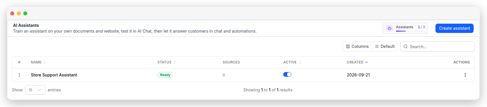
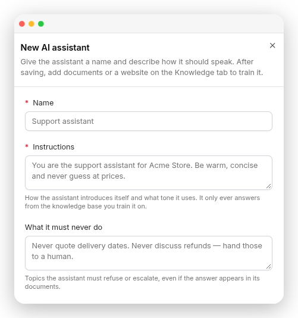
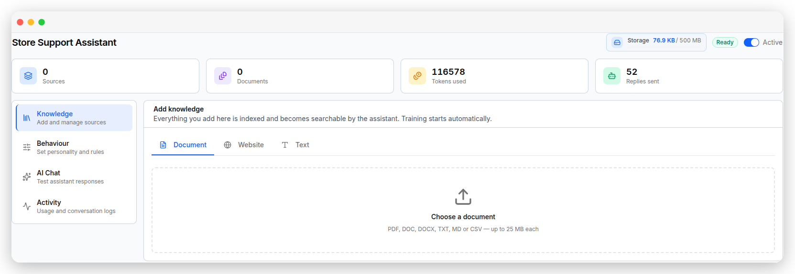
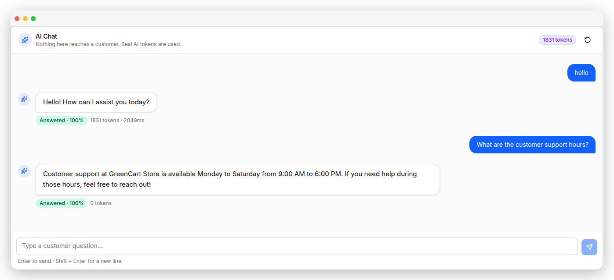
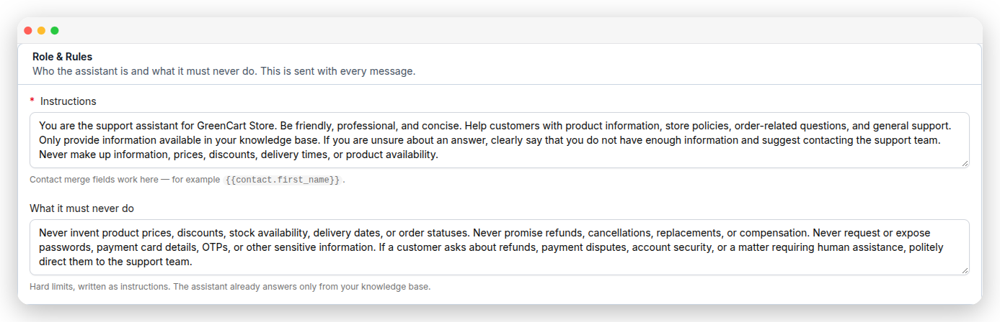
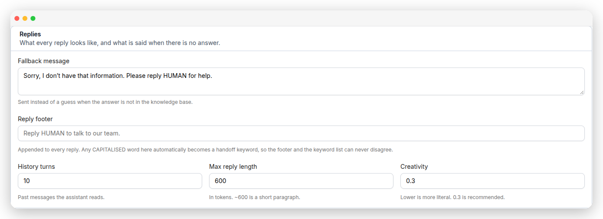
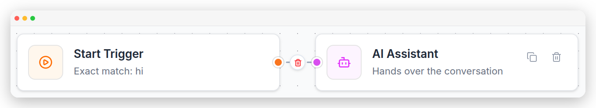

Customers ask the same questions every day: how long delivery takes, how returns work, which size to pick. An **AI Assistant** learns the answers from your own documents and website, and replies to those questions on WhatsApp for you, any time of day.

When it doesn't know the answer, or a customer asks for a person, it hands the chat to your team.

## What you get

<CardGroup cols={2}>
  <Card title="Answers at any hour" icon="clock">
    Customers get a reply straight away, even at night or on weekends.
  </Card>

  <Card title="Answers from your own information" icon="book-open">
    It replies using what you teach it: your policies, FAQs and website pages.
  </Card>

  <Card title="A person when it matters" icon="user-round">
    It passes the chat to your team when it isn't sure, or when a customer asks for a human.
  </Card>

  <Card title="Test before customers see it" icon="flask-conical">
    Ask it questions in a private test chat and fix its answers before you switch it on.
  </Card>
</CardGroup>

## Before you start

<AccordionGroup>
  <Accordion title="A connected WhatsApp number" icon="message-circle">
    The assistant replies from your connected number. See [Connect WhatsApp](/core-setup/channels/whatsapp).
  </Accordion>

  <Accordion title="The information you want it to use" icon="file-text">
    Gather what your customers usually ask about, such as your delivery, returns and size guides. It can be a file, pages on your website, or text you paste in.
  </Accordion>
</AccordionGroup>

## Set up your AI Assistant

<Steps>
  <Step title="Create the assistant" icon="plus">
    Click **AI Assistant** in the sidebar, then click **Create assistant**. Fill in:

    - **Name** _(required)_: a name only your team sees, such as "Support Assistant".
    - **Instructions** _(required)_: what the assistant does and how it should reply. For example: "You are the support assistant for Linen & Loom. Be friendly and keep replies short."
    - **What it must never do** _(optional)_: topics it should avoid or leave to your team. For example: "Never promise a refund."

    Click **Save**. The assistant opens on its own page.

    
  </Step>

  <Step title="Teach it on the Knowledge tab" icon="book-open">
    Open the **Knowledge** tab and add what the assistant should know. You can add three kinds of source:

    - **Document**: upload a PDF, DOC, DOCX, TXT, MD or CSV file, up to 25 MB each.
    - **Website**: enter a web address and click **Crawl website**. The assistant reads that page and the pages it links to on the same site.
      - Set **Max pages** to read up to 100 pages.
      - If your site changes often, set **Re-crawl every** so it reads the pages again after a number of days.
    - **Text**: enter a **Title**, type or paste your information, and click **Add text**.

    The assistant starts learning as soon as you add a source. When it's done, the source shows **Ready**.

    

    The **Activity** tab, next to **Knowledge**, **Behaviour** and **AI Chat**, shows the assistant's usage and conversation logs.
  </Step>

  <Step title="Test it in AI Chat" icon="flask-conical">
    Open the **AI Chat** tab and ask the questions your customers usually ask. These test messages never go to customers.

    Each reply shows its status, how confident the assistant was, and the AI tokens it used. If an answer is wrong or missing, add the information on the **Knowledge** tab and ask again.

    
  </Step>

  <Step title="Choose how it replies and when it hands over" icon="settings">
    Open the **Behaviour** tab. It has three sections, explained [below](#behaviour-settings). Click **Save behaviour** when you're done.
  </Step>

  <Step title="Turn it on" icon="power">
    Turn on the **Active** switch at the top of the page. The status shows **Ready** once the assistant has information it can answer from.
  </Step>

  <Step title="Add it to an automation" icon="workflow">
    The assistant replies to customers from inside an automation. Open a flow in the [flow builder](/automation/flow-builder) and add the [**AI Assistant**](/automation/flow-steps/advanced#ai-assistant) step from the **Advanced** tab. See [The AI Assistant step](#the-ai-assistant-step) below.
  </Step>
</Steps>

<Check>
  Create the assistant → teach it on **Knowledge** → test it in **AI Chat** → set its **Behaviour** → turn on **Active** → add it to an automation.
</Check>

## Behaviour settings

### Role & Rules

Your **Instructions** and **What it must never do** from when you created the assistant. You can change them here.

To use the customer's name in a reply, add the merge field `{{contact.first_name}}`.

### Replies

- **Fallback message**: what the assistant sends when the answer isn't in its knowledge.
- **Reply footer**: text added to the end of every reply, such as "Reply HUMAN to talk to our team." Any word written in CAPITALS here also works as a handoff word.
- **History turns**: how many earlier messages the assistant reads to follow the conversation.
- **Max reply length**: the longest a reply can be. 600 is about a short paragraph.
- **Creativity**: how closely replies stick to your information. A lower number keeps answers consistent. 0.3 is a good starting point.

### Handing over to a human

Choose when the assistant stops answering and leaves the chat to your team:

- **Handoff keywords**: words separated by commas. When a customer sends one, the assistant hands over straight away.
- **Hand off on low confidence**: hands over when the assistant isn't sure of its answer. **Minimum confidence** sets how sure it must be.
- **Unresolved turns before handoff**: how many questions it can fail to answer before it hands over.
- **Respect business hours**: uses your [business hours](/settings/business-hours) to decide what happens when you're closed. Choose **Reply as usual**, **Hand off to a human** or **Stay silent**.

## The AI Assistant step

In the flow builder, add the **AI Assistant** step and pick your **Assistant**. Only assistants that are **Ready** and **Active** appear in the list.

Then choose a **Mode**:

- **Hand over the conversation**: the assistant answers every new message until it hands the chat to your team. The flow stops after the handover. Use this for a support chatbot.
- **Answer one question**: the assistant answers one question, then stops until the flow runs again. This mode has a few more settings:
  - **Greeting message**: sent when the assistant starts, so the customer knows it's ready. Leave it empty to use the default greeting.
  - **Question**: what the assistant answers. Choose **The customer's last message**, or **A saved variable** with an answer collected earlier in the flow, such as from an [Ask Question](/automation/flow-steps/ask) step.
  - **Save answer as**: saves the reply so later steps can use it. With the default name, use it as `{{vars.ai_answer}}`.
  - **Send the answer to the customer**: on by default. Turn it off to only save the answer, so a later step decides what to send.
  - **Show typing indicator**: shows the customer a reply is on its way.

  After answering, the flow continues down an **answered** or **unanswered** path, so you can decide what happens next in each case.

**Example:** a **Start Trigger** for the message "hi", then an **AI Assistant** step set to **Hand over the conversation**. Customers can ask anything, and the assistant replies until it hands the chat to your team.

## Stop the assistant in a chat

You can take over a chat from the assistant at any time, even if the customer didn't ask for a person:

1. Open the chat in your **Inbox**.
2. Click the AI icon at the top. It only shows while the assistant is answering that chat.
3. The assistant stops replying to that customer straight away, and the icon disappears.

If the customer starts the automation again later, the assistant comes back on its own.

## Common questions

<AccordionGroup>
  <Accordion title="What happens when the assistant doesn't know the answer?">
    It sends your **Fallback message**. If you turned on **Hand off on low confidence**, or the customer reaches your **Unresolved turns before handoff**, it hands the chat to your team.
  </Accordion>

  <Accordion title="Can a customer ask to talk to a person?">
    Yes. Add words like HUMAN or AGENT to **Handoff keywords**, and mention them in your **Reply footer** so customers know. The assistant hands over as soon as a customer sends one.
  </Accordion>

  <Accordion title="Does it reply when my shop is closed?">
    You choose. Turn on **Respect business hours** on the **Behaviour** tab, then pick **Reply as usual**, **Hand off to a human** or **Stay silent**. See [Business hours](/settings/business-hours).
  </Accordion>

  <Accordion title="Do my test questions go to customers?">
    No. Messages in the **AI Chat** tab are only for testing and are never sent to anyone.
  </Accordion>

  <Accordion title="My website changed. Do I need to add it again?">
    No. Set **Re-crawl every** on the website source, and the assistant reads your pages again on that schedule.
  </Accordion>
</AccordionGroup>

## Where to next

<CardGroup cols={2}>
  <Card title="Flow builder" icon="workflow" href="/automation/flow-builder">
    Build the automation your assistant answers from.
  </Card>

  <Card title="Business hours" icon="clock" href="/settings/business-hours">
    Tell the assistant when your team is around.
  </Card>

  <Card title="Inbox" icon="messages-square" href="/messaging/live-chat">
    Pick up the chats the assistant hands over.
  </Card>

  <Card title="Question steps" icon="message-circle-question" href="/automation/flow-steps/ask">
    Collect an answer first, then let the assistant reply to it.
  </Card>
</CardGroup>
