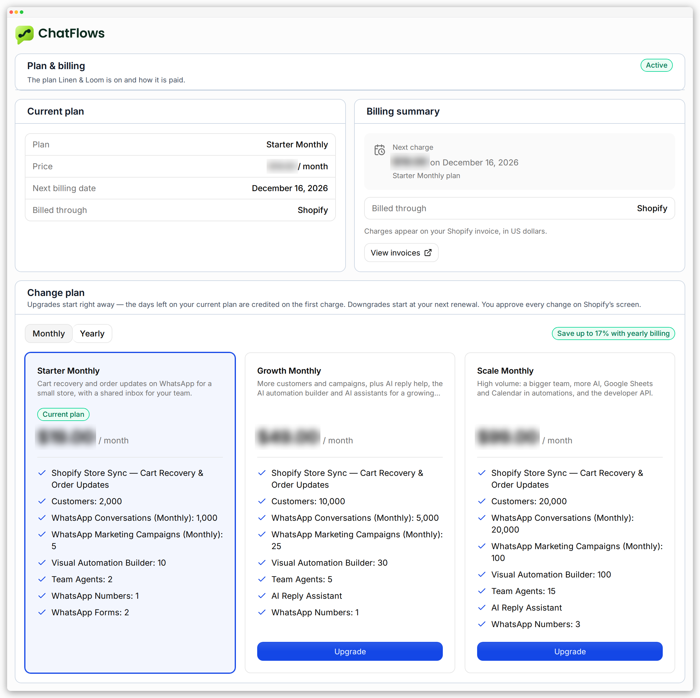
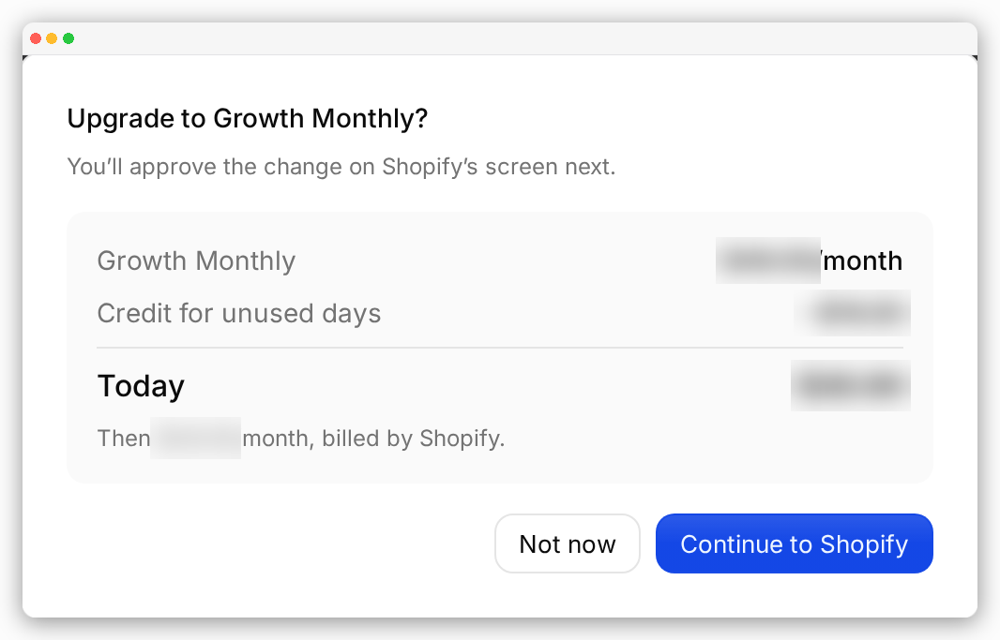

You pay for ChatFlows through **Shopify**. The charge is on your Shopify bill, so you don't need a separate card or payment method.

Plans are priced in US dollars. Shopify may show and charge the amount in your local currency, at the exchange rate on the day of each charge.

<Info>
  Only the workspace **owner** can change or cancel the plan.
  Team members can be allowed to **view** billing, but not to change it.
</Info>

## Choose a plan

There are three plans. Each one includes cart reminders and order updates on WhatsApp.

<CardGroup cols={3}>
  <Card title="Starter" icon="sprout">
    For a small store: cart reminders, order updates and a shared inbox for your team.
  </Card>

  <Card title="Growth" icon="trending-up">
    More customers and campaigns, plus AI help with replies and automations.
  </Card>

  <Card title="Scale" icon="rocket">
    For high volume: a bigger team, more WhatsApp numbers and the developer API.
  </Card>
</CardGroup>

You can pay **Monthly** or **Yearly**. Paying yearly costs less than paying monthly for 12 months.

For current prices and exactly what each plan includes, see the [plan comparison on chatflows.io](https://chatflows.io/#pricing).

<Note>
  **Does WhatsApp charge me separately?** Yes. Meta bills its WhatsApp message charges to you directly. They aren't part of your ChatFlows plan, and ChatFlows adds nothing on top. See [WhatsApp costs](/billing/whatsapp-costs).
</Note>

## Free trial

Every paid plan starts with a **14-day free trial**. Shopify shows the trial on the approval screen when you pick the plan.

- Each store gets the trial only once.
- When the trial ends, Shopify charges you. You don't need to do anything.
- To avoid the charge, cancel before the trial ends. See [Cancel](#cancel-your-plan) below.

## Where to see your plan

You can see your plan in two places:

- **In your Shopify admin:** open ChatFlows and click **Plan & billing**.
  You see your **Current plan** and a **Billing summary** with the next charge date and amount.
- **In your dashboard:** click your name at the bottom of the menu, then **My Subscription**.

## Upgrade your plan

<Steps>
  <Step title="Open Plan & billing">
    In your Shopify admin, open ChatFlows and click **Plan & billing**.

    
  </Step>
  <Step title="Pick a plan">
    Under **Change plan**, choose **Monthly** or **Yearly**, then click **Upgrade** on the plan you want.
    A box shows the new plan's price, the credit for your unused days, and what you pay today.

    
  </Step>
  <Step title="Approve in Shopify">
    Click **Continue to Shopify**. Shopify shows its own approval screen. Approve it.
  </Step>
</Steps>

Your new plan starts right away. The unused days of your old plan are taken off your first charge.
If you upgrade during a free trial, the trial ends and nothing is taken off.

## Downgrade your plan

Follow the same steps and pick a cheaper plan. Then approve in Shopify.

You keep your current plan until your next renewal date. Then the new plan starts.
Until then, **Plan & billing** shows the scheduled change with an **Undo** button.

## Your invoice

Shopify charges your plan, so your invoice is your **Shopify bill**. In your Shopify admin, go to **Settings → Billing → Bills**. The ChatFlows charge is listed as an app charge.

ChatFlows doesn't send a second invoice, so each payment has exactly one.

## Cancel your plan

You can cancel in any of these ways:

- Uninstall the ChatFlows app from your Shopify store.
- In your dashboard, open **My Subscription** and click **Cancel Subscription**.
- In your dashboard, open **My Subscription** and turn off auto-renewal.

**You keep full access until the end of the period you paid for.** Nothing stops today.
Shopify won't charge you again.

After that date your workspace becomes inactive, and you can't send or receive messages.
To continue, pick a plan again in **Plan & billing** in your Shopify admin. Everything you built is still there.

## If your account is suspended

You see an **Account Suspended** screen instead of your workspace. You can't fix this yourself.

## Where to next

<CardGroup cols={2}>
  <Card title="Dashboard & usage" icon="gauge" href="/reporting/dashboard-and-usage">
    See how much of your plan you have used.
  </Card>

  <Card title="WhatsApp costs" icon="receipt" href="/billing/whatsapp-costs">
    What Meta charges for messages, and how to estimate your monthly bill.
  </Card>

  <Card title="Connect your WhatsApp number" icon="message-circle" href="/core-setup/channels/whatsapp">
    Set up the number your store sends from.
  </Card>
</CardGroup>
