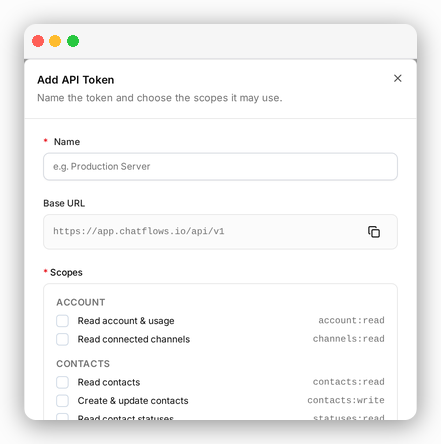
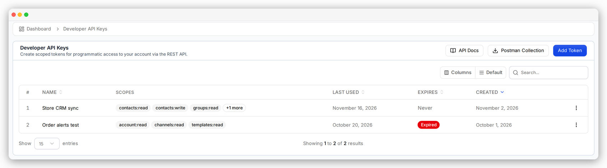

An API token lets another app connect to your workspace. After you create a token, that app can use it to access your data and perform actions based on the permissions you allow.

Find it under **Setup → Developer API Keys**.

## Creating a token

<Steps>
<Step title="Name it and set permissions">
  Click **Add Token**. Enter a name so you can identify the token later, such as Website or Zapier, then choose only the permissions the app needs.

  
</Step>

<Step title="Set an expiry date (optional)">
  Choose when the token should expire, or leave it empty so it never expires.
</Step>

<Step title="Copy the token">
  After you create the token, copy it and save it somewhere safe — it's shown only once and can't be viewed again.
</Step>
</Steps>

## Your tokens

The list shows each token's **name**, **permissions**, **last used date**, **expiry date**, and **created date**. If a token never expires, it shows Never. You can also search by token name.



At the top of the page, you'll find two helpful buttons:

- **API Docs** — View the complete API documentation.
- **Postman Collection** — Download ready-to-use API requests for Postman.

## Regenerate or revoke

Open a token's `⋮` menu for its two actions:

- **Regenerate** — Generates a new token to replace the current one. The old token stops working right away, so update your app with the new one.
- **Revoke** — Permanently deletes the token. Any app using it will stop working immediately.

<Warning>
You cannot change a token's name or permissions after creating it. If you need different permissions, create a new token and revoke the old one.
</Warning>

## Using your token

Send the token with every request, in the `Authorization` header:

```text
Authorization: Bearer YOUR_API_TOKEN
```

Send it to the **Base URL** shown on the Add API Token form, followed by the endpoint path. For example:

```bash
curl -H "Authorization: Bearer YOUR_API_TOKEN" \
  https://app.chatflows.io/api/v1/contacts
```


## What's next

<CardGroup cols={2}>
  <Card title="API Overview" icon="book" href="/overview">
    The base URL, pagination, and every available endpoint.
  </Card>

  <Card title="Webhooks" icon="webhook" href="/settings/webhooks">
    Get events sent to your own system as they happen.
  </Card>
</CardGroup>
