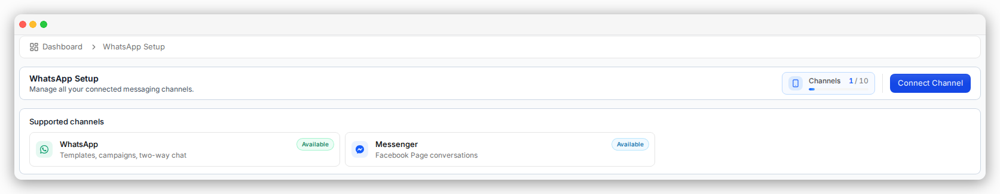
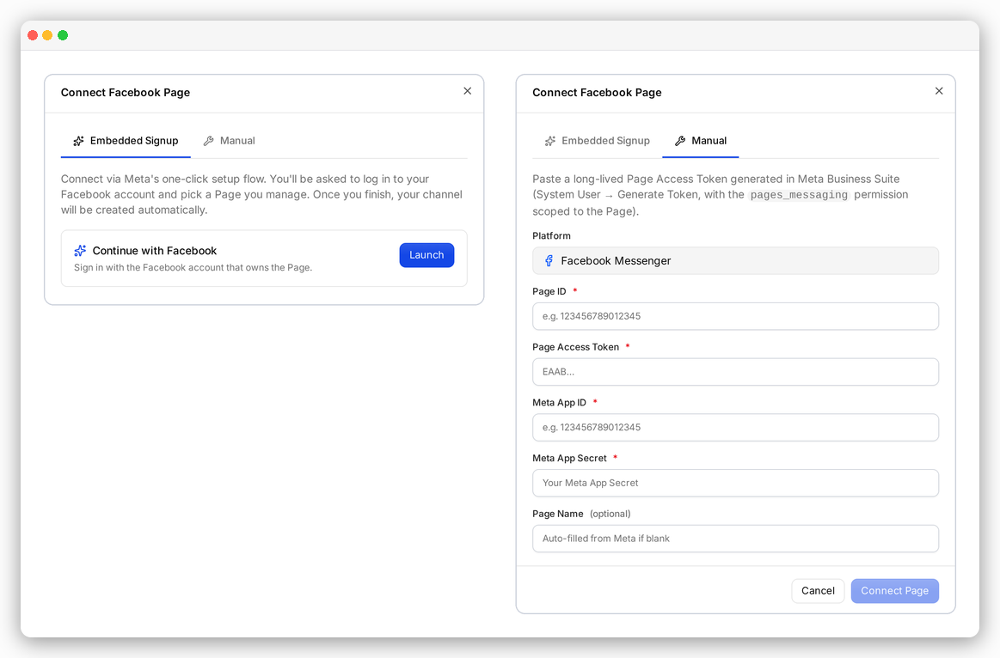
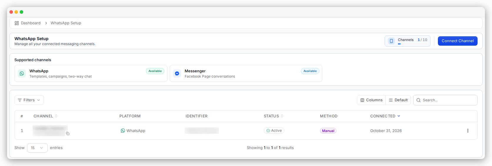
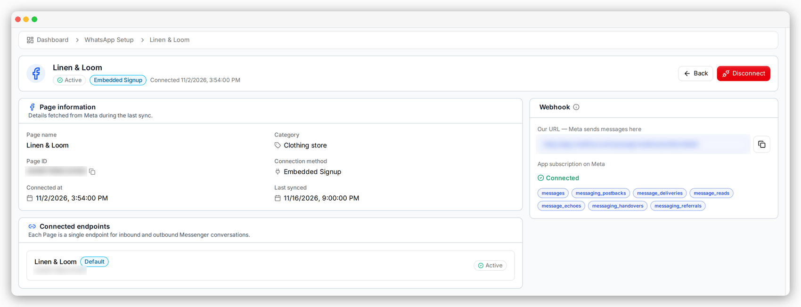

Plenty of customers message a store on Facebook first. Connect your store's Facebook Page, and those Messenger chats arrive in the same **Inbox** as WhatsApp, so your team answers both from one place.

## Before you connect

<Tip>
Make sure you have the following ready:

- A Facebook account.
- A Meta Business account — Business Verification is not mandatory to connect, but it is strongly recommended; without it your account stays on limited messaging tiers.
- A Facebook Page that you manage and want to connect to Messenger.
- Your Page ID, Page Access Token, Meta App ID, and Meta App Secret (for manual connections only).
</Tip>

## Connecting Messenger

<Steps>
<Step title="Click Connect">
  Go to **WhatsApp Setup**, click **Connect Channel**, choose **Messenger**, then click **Continue**.
  
  
</Step>

<Step title="Pick a connection method">
  You'll see two tabs:

  

  - **Embedded Signup** — connect with Meta's secure Facebook login flow.
    - Sign in using your Facebook credentials.
    - Select the Page you want to connect.
    - Confirm the requested permissions.
    - The connection completes automatically and the pop-up closes when done.
  - **Manual** — use this for advanced setups with existing Meta credentials.
    - Enter the **Page ID**.
    - Paste the **Page Access Token**.
    - Provide the **Meta App ID** and **Meta App Secret**.
</Step>

<Step title="Confirm it's connected">
  Once connected, the Page appears in your list on the **WhatsApp Setup** page marked **Active**, and incoming Messenger conversations start reaching your workspace automatically.
</Step>
</Steps>

## Managing a connected Page

Open a connected Messenger channel to:

- **Review Page information** fetched from Meta, including Page name, Page ID, category, and connection method.
- **Check** channel health and **view webhook subscription status**.
- **Disconnect** the Page.

<Tip>
You can connect more than one Facebook Page — manage all of them from the same **WhatsApp Setup** page, alongside your WhatsApp channels.
</Tip>

## What's next

<CardGroup cols={2}>
  <Card title="Connect WhatsApp" icon="message-circle" href="/core-setup/channels/whatsapp">
    Connect a WhatsApp Business Account the same way.
  </Card>

  <Card title="Inbox" icon="messages-square" href="/messaging/live-chat">
    Start replying to Messenger conversations from the unified team inbox.
  </Card>
</CardGroup>
