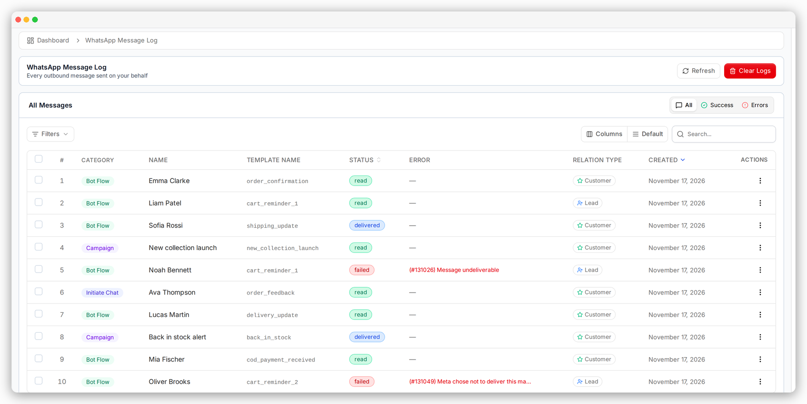
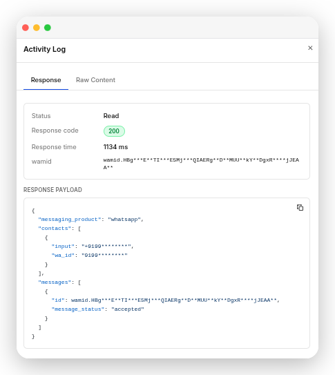

When a customer says "I never got your message", look here first. This page shows all WhatsApp messages sent from your workspace, whether they were sent from a **[campaign](/messaging/campaigns)**, **[automation](/automation/overview)**, or **[chat](/messaging/live-chat)**. You can use it to check sent messages and see why any message failed.

Find it under **Setup → WhatsApp Message Log**.

## The message list

| Column | What it shows |
| --- | --- |
| **Category** | Where the message was sent from, such as a campaign, automation, or chat. |
| **Name** | The campaign, automation, or contact name. |
| **Template Name** | The template used, if any. |
| **Status** | The current message status. |
| **Error** | The reason the message failed, if any. |
| **Relation Type** | The recipient type, such as Guest, Lead, or Customer. |
| **Created** | When the message was sent. |

## Message statuses

| Status | What it means |
| --- | --- |
| **pending** | The message is waiting to be sent. |
| **accepted** | WhatsApp has accepted the message. |
| **sent** | The message has been sent. |
| **delivered** | The message reached the recipient. |
| **read** | The recipient has opened the message. |
| **failed** | The message was not sent. Check the Error column to see why. |

## View message details

Open the `⋮` menu and choose **View** to see more information about the message:

- **Response** — Shows the current message status, WhatsApp response code, response time, message ID (WAMID), and the response payload returned by WhatsApp.
- **Raw Content** — Shows the original request sent to WhatsApp, including the message type, phone number ID, business account ID, request payload, and other message details.

<Note>
Deleting a campaign or an automation also removes its messages from this log.
</Note>

## What's next

<CardGroup cols={2}>
  <Card title="Activity Log" icon="history" href="/reporting/activity-logs">
    See every action taken in your workspace.
  </Card>

  <Card title="Automations" icon="zap" href="/automation/overview">
    Build automations that send messages automatically.
  </Card>
</CardGroup>
