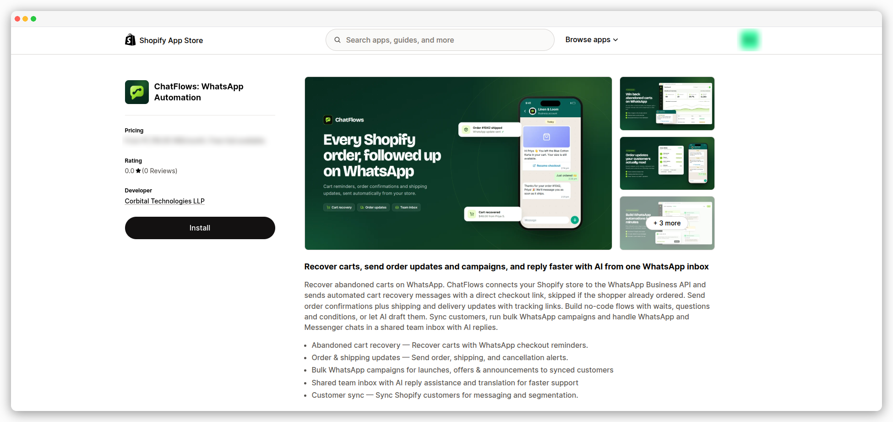
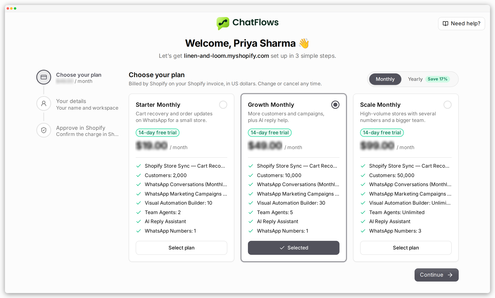
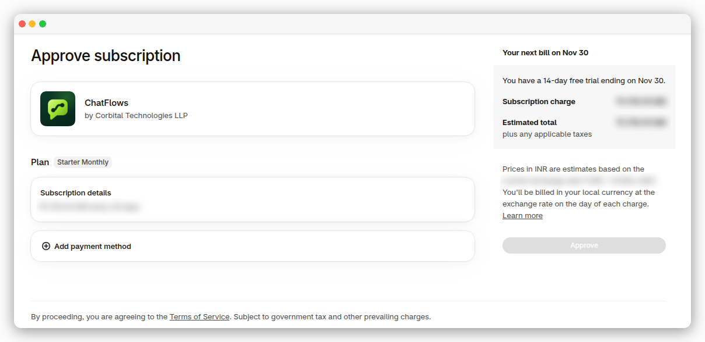
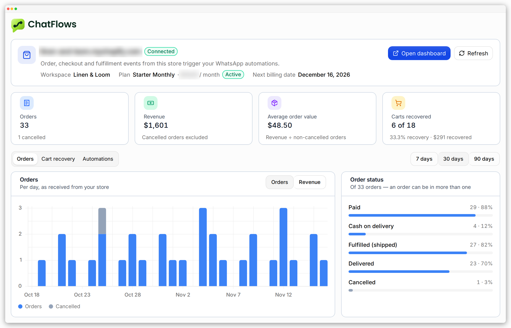
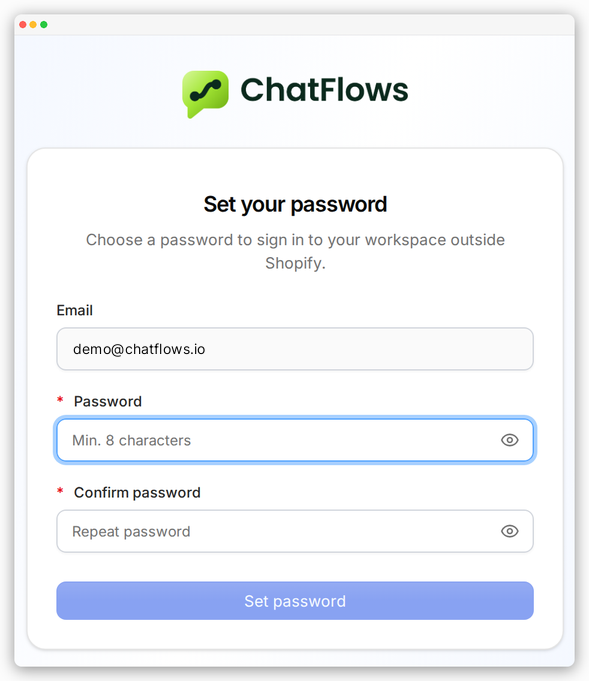

There's no separate account to create. Shopify fills in your details, and once you choose your plan, your ChatFlows workspace is ready and connected to your store.

## Steps

<Steps>
  <Step title="Install the app" icon="plus">
    Open [ChatFlows: WhatsApp Automation](https://apps.shopify.com/chatflows) in the Shopify App Store and click **Install**.

    
  </Step>

  <Step title="Approve the access" icon="shield-check">
    Shopify shows what ChatFlows can read in your store, like orders, checkouts and customers.
    Approve it to continue. ChatFlows only reads your store. It never changes your products or orders.
  </Step>

  <Step title="Pick a plan" icon="list-checks">
    The **Choose a plan** screen opens. Choose **Monthly** or **Yearly** billing, then pick a plan.
    A plan may come with a free trial.

    Under **Your details**, check your name, email, workspace name and country.
    These are filled in from Shopify. The phone number is optional.

    Tick **I agree to the Terms of Service and Privacy Policy**, then click **Continue to Shopify**.

    
  </Step>

  <Step title="Approve the charge in Shopify" icon="credit-card">
    Shopify shows its own **Approve subscription** screen. It shows your plan, when your free trial ends, and the charge.

    If you have no payment method in Shopify yet, click **Add payment method** first. Then click **Approve**.

    

    Shopify may show the price in your local currency. If you pick a free plan, there is nothing to approve. Click **Create my workspace** instead.
    See [Plan and billing](/billing/plan-and-billing) for how Shopify charges you.
  </Step>

  <Step title="Open your dashboard" icon="layout-dashboard">
    After you approve, Shopify brings you back to ChatFlows in your Shopify admin.
    Your workspace is created and your store shows as **Connected**.

    Click **Open dashboard**. You are signed in to your workspace straight away. You don't need a password.

    
  </Step>

  <Step title="Set a password" icon="key-round">
    Your dashboard shows a blue bar: **Set a password to sign in without Shopify**. Click **Set a password**.

    On the **Set your password** page, your email is already filled in.
    Enter a password of at least 8 characters, with an uppercase letter, a lowercase letter, a number and a symbol. Enter it again, and click **Set password**.

    

    This step is optional. Without a password, you sign in from your Shopify admin with **Open dashboard**.
    With a password, you can also sign in from any browser.
  </Step>
</Steps>

<Check>
  **Done.** Install the app → approve the access → pick a plan → approve in Shopify → open your dashboard. Your store is now connected.
</Check>

## What to do next

You do your real work in the dashboard: connect WhatsApp, write templates, build automations and reply to customers.
See [Your store and the Shopify app](/shopify/shopify-admin-app) for what the app in Shopify shows.

## Common questions

<AccordionGroup>
  <Accordion title="I already have a ChatFlows workspace">
    On the plan screen, under **Already have a workspace?**, click **Sign in to link this store**.
    After you sign in, the store is connected to your workspace.
    Only the workspace owner can do this. Your billing stays the same.
  </Accordion>

  <Accordion title="Shopify declined the charge">
    You go back to the plan screen. Your details are kept. Pick a plan and try again.
  </Accordion>

  <Accordion title="I approved the charge, then closed the tab">
    Open ChatFlows from your Shopify admin again and click **Check again**.
    ChatFlows also finishes setting up your workspace by itself, even if you do nothing.
  </Accordion>

  <Accordion title="I uninstalled the app and installed it again">
    Your store connects back to the same workspace. Nothing you built is lost.
  </Accordion>

  <Accordion title="I skipped setting a password">
    That's fine. Open ChatFlows from your Shopify admin and click **Open dashboard** to sign in.
    You can set a password later from the blue bar in your dashboard.
    You also get an email, **Your workspace is ready**, with a link to set your password. The link works for 7 days.
  </Accordion>
</AccordionGroup>

## Where to next

<CardGroup cols={2}>
  <Card title="Connect your WhatsApp number" icon="message-circle" href="/core-setup/channels/whatsapp">
    Nothing can be sent until a number is connected.
  </Card>

  <Card title="Recover abandoned carts" icon="shopping-cart" href="/shopify/cart-recovery">
    Remind customers who left without paying.
  </Card>
</CardGroup>
