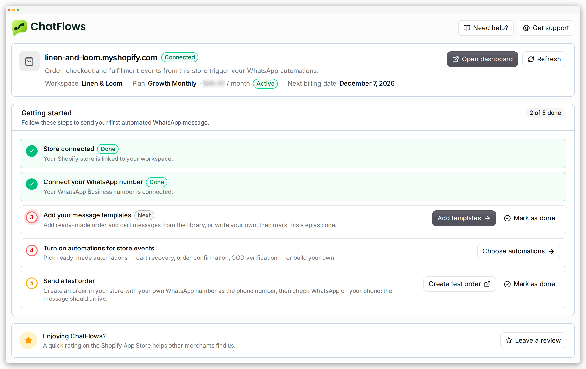

There's no separate account to create. Shopify fills in your details, and once you choose your plan, your ChatFlows workspace is ready and connected to your store.

## Steps

<Steps>
  <Step title="Install the app" icon="plus">
    Open [ChatFlows: WhatsApp Automation](https://apps.shopify.com/chatflows) in the Shopify App Store and click **Install**.

    
  </Step>

  <Step title="Approve the access" icon="shield-check">
    Shopify shows what ChatFlows can access in your store, like orders, checkouts and customers.
    Approve it to continue. ChatFlows never changes your products, and changes an order (tags, notes, a hold or a cancellation) only when one of your automations does it.
  </Step>

  <Step title="Pick a plan" icon="list-checks">
    The plan screen welcomes you by name and walks you through three short steps.

    First, choose **Monthly** or **Yearly** billing. The **Yearly** option shows how much you save.
    Click the plan you want, then click **Continue**.

    

    Next, under **Your details**, check your name, email, workspace name and country. These are filled in from Shopify.
    Enter your **Phone number**. It is required. When you pick your country, the phone number's country code changes to match, and you can still change it yourself.

    Below the form you see your plan, the length of your free trial, and what is due today.
    Tick **I agree to the Terms of Service and Privacy Policy**, then click **Start 14-day free trial**. If your plan has no free trial, the button says **Continue to Shopify**.

    
  </Step>

  <Step title="Approve the charge in Shopify" icon="credit-card">
    Shopify shows its own **Approve subscription** screen. It shows your plan, when your free trial ends, and the charge.

    If you have no payment method in Shopify yet, click **Add payment method** first. Then click **Approve**.

    

    Shopify may show the price in your local currency.
    See [Plan and billing](/billing/plan-and-billing) for how Shopify charges you.
  </Step>

  <Step title="Open your dashboard" icon="layout-dashboard">
    After you approve, Shopify brings you back to ChatFlows in your Shopify admin.
    You see **Almost there…** for a few seconds while ChatFlows links your store's orders and checkouts.
    Then your store shows as **Connected**, with a **Getting started** checklist of the next steps.

    

    Click **Open dashboard**. Your workspace opens in a new tab and you are signed in straight away. You don't need a password.
  </Step>

  <Step title="Set a password" icon="key-round">
    Your dashboard shows a blue bar: **Set a password so you can also sign in directly, without going through Shopify.** Click **Set a password**.

    On the **Set your password** page, your email is already filled in.
    Enter a password of at least 8 characters, with an uppercase letter, a lowercase letter, a number and a symbol. Enter it again, and click **Set password**.

    

    This step is optional. Without a password, you sign in from your Shopify admin with **Open dashboard**.
    With a password, you can also sign in from any browser.
  </Step>
</Steps>

<Check>
  **Done.** Install the app → approve the access → pick a plan → approve in Shopify → open your dashboard. Your store is now connected.
</Check>

## What to do next

You do your real work in the dashboard: connect WhatsApp, write templates, build automations and reply to customers.
See [Your store and the Shopify app](/shopify/shopify-admin-app) for what the app in Shopify shows.

## Common questions

<AccordionGroup>
  <Accordion title="I already have a ChatFlows workspace">
    Enter the email of your existing account under **Your details** and click the start button.
    ChatFlows sees that the email already has an account and shows **Sign in to link this store** under the **Email** field. Click it and sign in.
    After you sign in, the store is connected to your workspace.
    Only the workspace owner can do this. Your billing stays the same.
  </Accordion>

  <Accordion title="Shopify declined the charge">
    You go back to the plan screen. Your details are kept. Pick a plan and try again.
  </Accordion>

  <Accordion title="I approved the charge, then closed the tab">
    Open ChatFlows from your Shopify admin again and click **Check again**.
    ChatFlows also finishes setting up your workspace by itself, even if you do nothing.
  </Accordion>

  <Accordion title="I uninstalled the app and installed it again">
    Your store connects back to the same workspace. Nothing you built is lost.
  </Accordion>

  <Accordion title="I skipped setting a password">
    That's fine. Open ChatFlows from your Shopify admin and click **Open dashboard** to sign in.
    You can set a password later from the blue bar in your dashboard.
    You also get an email, **Your workspace is ready**, with a link to set your password. The link works for 7 days.
  </Accordion>
</AccordionGroup>

## Where to next

<CardGroup cols={2}>
  <Card title="Connect your WhatsApp number" icon="message-circle" href="/core-setup/channels/whatsapp">
    Nothing can be sent until a number is connected.
  </Card>

  <Card title="Recover abandoned carts" icon="shopping-cart" href="/shopify/cart-recovery">
    Remind customers who left without paying.
  </Card>
</CardGroup>
