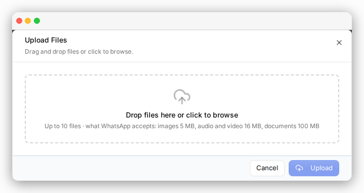
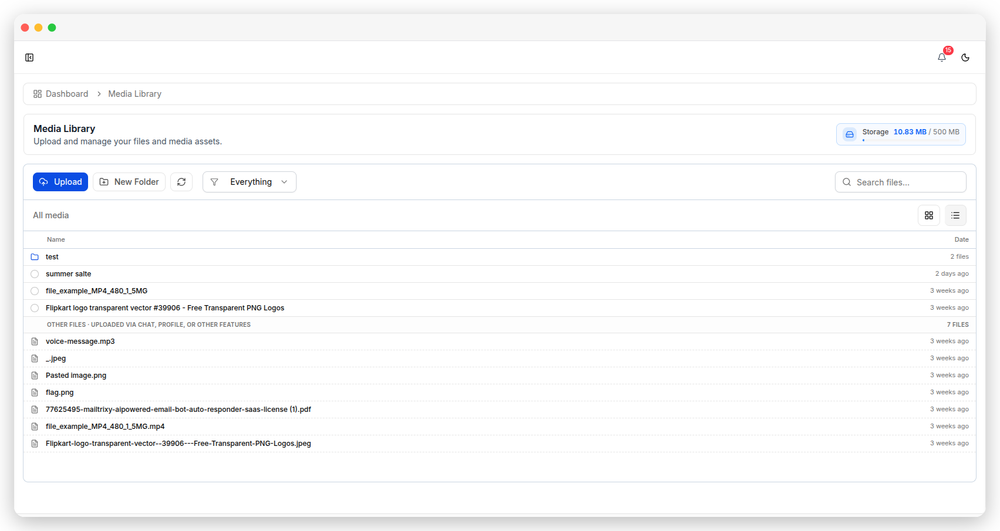
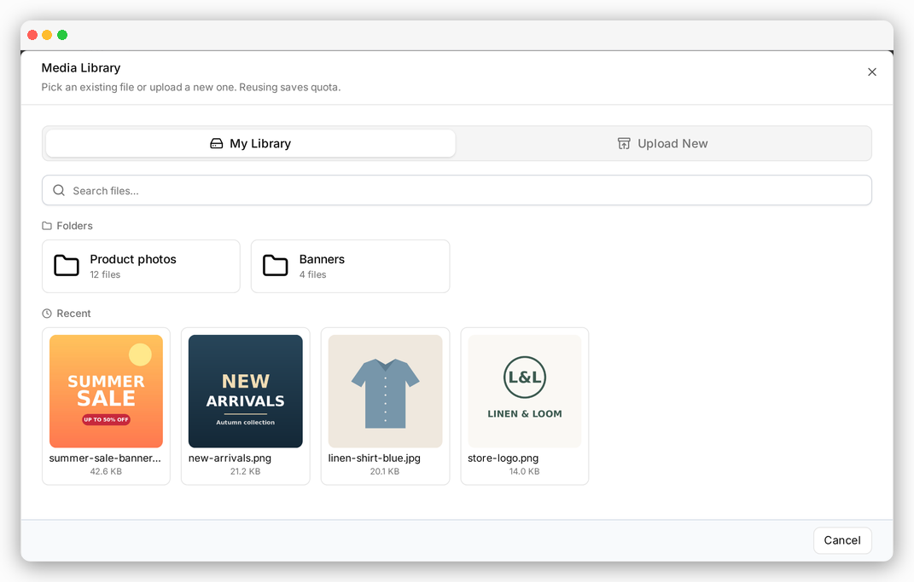
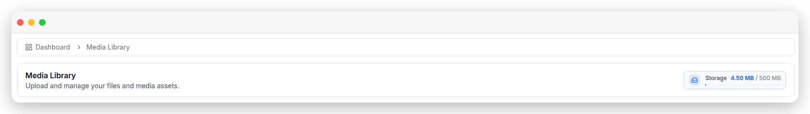

The Media Library stores all your files in one place. Upload a photo, video, audio file, or document once, then use it anywhere in ChatFlows without uploading it again.

## Uploading files

Click **Upload**, then drag and drop your files or choose them from your computer.

You can upload up to **10 files at a time**, with a maximum size of **16 MB per file**.

Supported file types are:

- **Images** — JPG, PNG, GIF, and WEBP.
- **Documents** — PDF, DOC, DOCX, XLS, XLSX, CSV, and TXT.
- **Audio** — MP3, OGG, AAC, M4A, AMR, and OPUS.
- **Video** — MP4, MOV, and 3GP.

## Organizing with folders

Use folders to organize your files.

Click **New Folder** to create a folder. You can also create folders inside other folders. Move files into a folder one by one, or select multiple files and move them together.

<Warning>
Deleting a folder deletes every file inside it. Move out anything you want to keep first.
</Warning>

## Finding a file

Search by name, or use the **type** filter to show only images, PDFs, video or audio. Switch between a grid and a list view, whichever you prefer. Files are shown newest first.

## File details and actions

Click a file to open its details on the right — its name, type, size, upload date, and folder. From here you can:

- **Copy URL** — copy a link to the file.
- **Open file** — open it in a new tab.
- Move it to a folder.
- Delete it.

## Use a file from your Media Library

Wherever you need to attach a file in ChatFlows, the Media Library opens with two tabs:

- **My Library** — pick a file you have already uploaded.
- **Upload New** — add a new one.

You will see this window in many places, such as:

- **[Inbox](/messaging/live-chat)** 
- **[Quick replies](/core-setup/canned-replies)**
- **[Campaigns](/messaging/campaigns)** 
- **[WhatsApp templates](/messaging/whatsapp-templates)**
- **[Messenger templates](/messaging/messenger-templates)**
- **[WhatsApp Forms](/messaging/whatsapp-forms)**
- **[Your profile photo](/settings/profile)**

## Storage space

Your workspace has a storage limit. The Media Library shows how much storage you have used.

## What's next

<CardGroup cols={2}>
  <Card title="WhatsApp Templates" icon="file-text" href="/messaging/whatsapp-templates">
    Use a library file as a template header image or video.
  </Card>

  <Card title="Dashboard & Usage" icon="gauge" href="/reporting/dashboard-and-usage">
    Check how much you've used and your limits.
  </Card>
</CardGroup>
