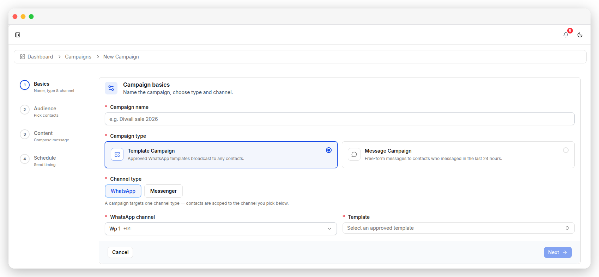
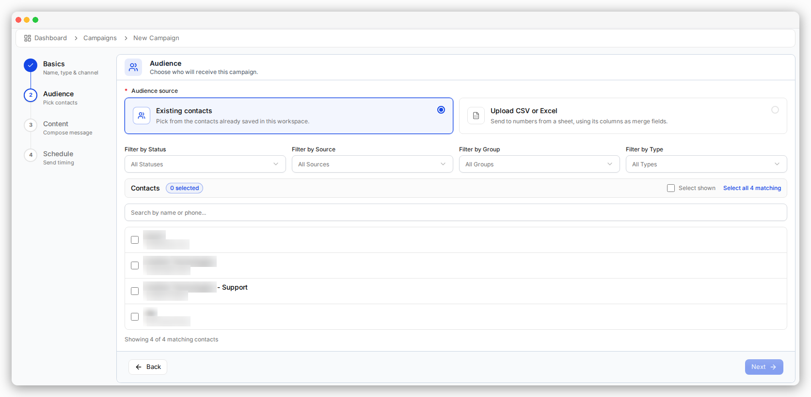
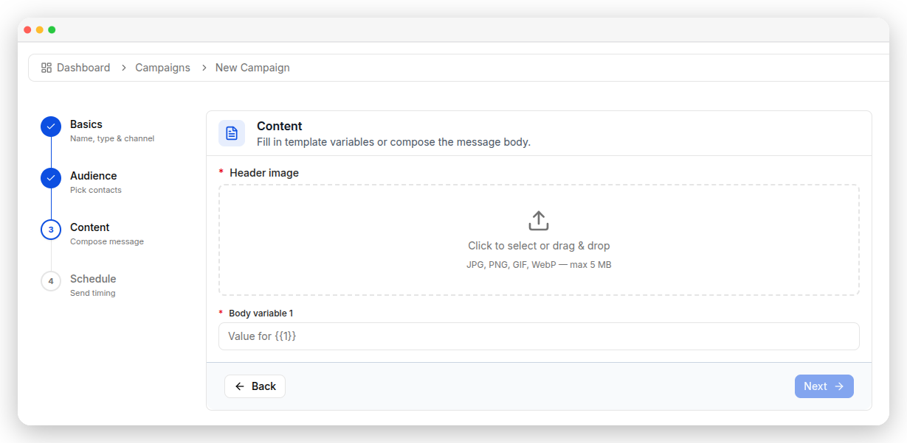
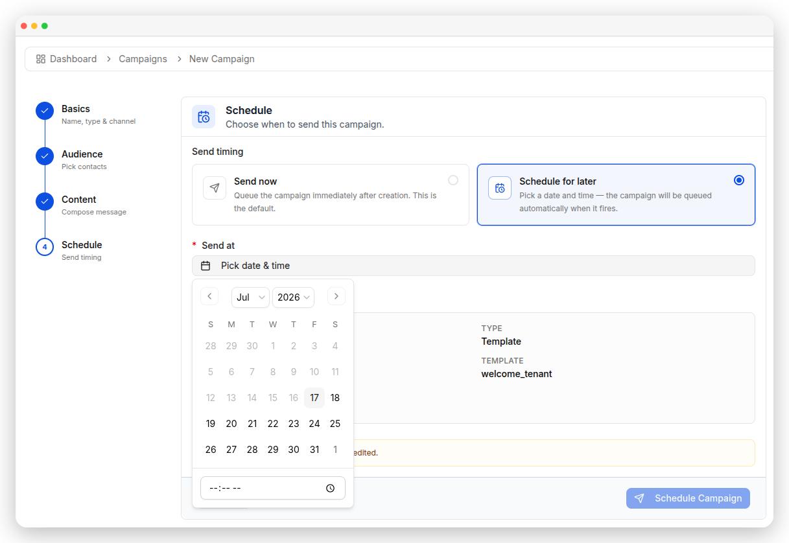
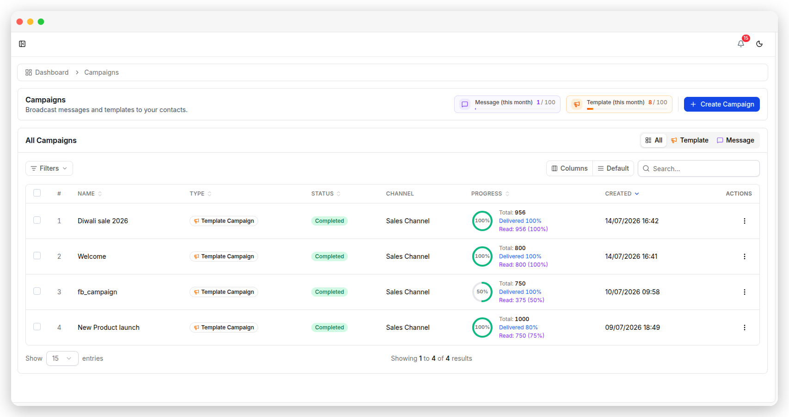
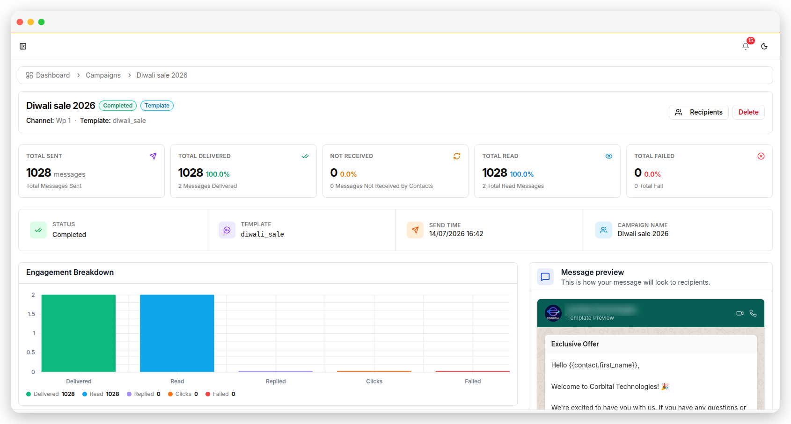
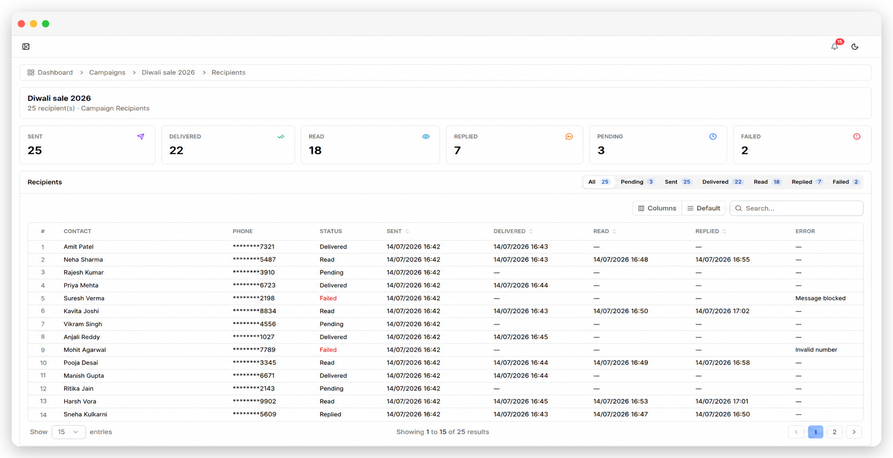

A campaign sends the same message to many contacts at once. Use it for an offer, an announcement, or a follow-up to a group of people.

<Note>
Before you start, **[connect a channel](/core-setup/channels/whatsapp)**, add **[customers](/contacts/managing-contacts)**, and have an approved **[template](/messaging/whatsapp-templates)** if you're creating a template campaign.
</Note>

## The two campaign types

You select one of two types when you create a campaign.

### Template campaign

Sends a Meta-approved **[template](/messaging/whatsapp-templates)**. It can reach **any** contact on the channel. You need an approved template first. Use it for offers, announcements, and reminders.

### Message campaign

A message you create yourself using text, images, videos, or buttons. You can send it only to people who have messaged you in the [last 24 hours](/getting-started/concepts#two-whatsapp-rules-that-shape-everything). No approved template is needed.

## Creating a campaign

Campaigns are built in four steps. A live preview of your message shows on the right as you go.

<Steps>
<Step title="Basics">
  

  - **Campaign name** — a name only you see, like *Diwali sale 2026*.
  - **Campaign type** — choose **Template** or **Message** (see the two types above).
  - **Channel** — which of your [channels](/core-setup/channels/whatsapp) to send from.
  - **Template** — for a template campaign, select the approved [template](/messaging/whatsapp-templates) to send.
</Step>

<Step title="Audience">
  Select the exact contacts who should receive the campaign.

  

  Filter the list with the **[status](/core-setup/statuses)**, **[source](/core-setup/sources)**, **[group](/core-setup/groups)** and **type** filters, or search by name or phone. Select the contacts you want, or use **Select all filtered** to tick everyone in the current filtered list. You need at least one contact to continue.
</Step>

<Step title="Content">
  Write what you want to send.

  

  - **Template campaign** — fill in the [template](/messaging/whatsapp-templates)'s variables. If the template has a media header, upload the image or file here.
  - **Message campaign** — write a **header** (optional), a **body**, and a **footer** (optional). You can also add up to three reply **buttons**, a single **call-to-action** link, or attach an image, video or document.

  Type `@` in any text field to add a [merge field](/messaging/merge-fields) like the contact's name.
</Step>

<Step title="Schedule">
  Choose when to send it.

  

  - **Send now** — the campaign is sent as soon as you create it.
  - **Schedule for later** — select a date and time. Confirm your [timezone](/settings/general) first, so it sends at the right time.

  <Warning>
  Once a campaign starts sending you cannot edit it. Check the summary before you send.
  </Warning>
</Step>
</Steps>

## Messenger campaigns

If you have a Messenger channel connected, you can pick it as the channel type in [step 1](#creating-a-campaign).

Messenger has one important difference: **both** message and template campaigns can only reach contacts who messaged your Facebook Page in the **last 7 days**.

## Campaign statuses

The status shows the current stage of the campaign.

| Status |  It means |
| --- | --- |
| **Draft** | Made but not sent yet. You can still edit it, and send it when you're ready. |
| **Queued** | Scheduled and waiting for its send time. |
| **Preparing** | Getting the list of recipients ready. This lasts a moment. |
| **Sending** | Messages are going out right now. |
| **Paused** | Sending is on hold. Resume it to carry on. |
| **Completed** | Every recipient has been handled. |
| **Failed** | The campaign could not run, often because no one was eligible to receive it. |
| **Cancelled** | You stopped it. Anyone not yet sent to will not be sent to. |

## Campaign reports

Open any campaign to see its report.

At the top you see the campaign **name**, its **status**, and its **type**. On the right, **Recipients** opens the list of customers in the campaign, and **Delete** removes it.

Below, you can see how many messages were sent, delivered, not received, read, and failed. You can also see a chart of these results and a preview of your message.

While a campaign is running, you can **Pause**, **Resume**, or **Cancel** it. After it finishes, **Resend Failed** sends the message again only to contacts who did not receive it.

<Note>
Campaign messages don't show up in the [Inbox](/messaging/live-chat).
</Note>

## Recipients

Click **Recipients** to see everyone in the campaign. You can filter the list by message status (All, Pending, Sent, Delivered, Read, Replied, or Failed) and see the reason if a message failed.

Open the **Replied** tab to see all contacts who replied to your campaign. Click **New Campaign for Replied** to create a new campaign for only those contacts.

## Common reasons for failed messages

If a message fails, open the campaign's Recipients list to see why it failed for each contact.

| Reason | What it means |
| --- | --- |
| **Message undeliverable** | The number is not on WhatsApp, or the person cannot receive your message. |
| **Not delivered to maintain healthy ecosystem engagement** | WhatsApp is limiting how many marketing messages this person gets right now. Try again later, or send fewer marketing messages. |
| **24-hour window closed** | The contact last messaged you more than 24 hours ago, so a message campaign cannot reach them. Use a template campaign instead. |
| **Recipient not in allowed list** | Your number is still in test mode. Finish verifying your WhatsApp account to message anyone. |
| **Country not allowed** | WhatsApp does not allow messages to that contact's country. There is nothing you can change here. |

<Note>
The table above covers the common reasons. For more details, see [Meta's error codes](https://developers.facebook.com/docs/whatsapp/cloud-api/support/error-codes/).
</Note>

## Common questions

<AccordionGroup>
  <Accordion title="Can I send a WhatsApp campaign to all my Shopify customers?">
    Yes. ChatFlows can send a template campaign to any contact on your WhatsApp channel, including customers from your Shopify store, once they are in your contact list.
    In the audience step, use **Select all filtered** to pick everyone. See [Manage your Shopify customers](/contacts/managing-contacts).
  </Accordion>

  <Accordion title="Do customers who replied STOP still get my WhatsApp campaign?">
    No. ChatFlows stops marketing campaigns for customers who reply STOP, across all your WhatsApp numbers and Messenger.
    Order and shipping updates still go out. See [Opt-out](/settings/opt-out).
  </Accordion>

  <Accordion title="Can I schedule a WhatsApp campaign to send later?">
    Yes. In the last step of the campaign, choose **Schedule for later** and pick a date and time.
    Confirm your [timezone](/settings/general) first, so it sends when you expect.
  </Accordion>

  <Accordion title="Can I resend a campaign to the people it failed for?">
    Yes. After the campaign finishes, **Resend Failed** sends the message again only to contacts who did not receive it.
    Open the campaign's **Recipients** list first to see why each message failed.
  </Accordion>
</AccordionGroup>

## What's next

<CardGroup cols={2}>
  <Card title="WhatsApp Templates" icon="file-text" href="/messaging/whatsapp-templates">
    Get a template approved so you can run a template campaign.
  </Card>

  <Card title="Merge Fields" icon="at-sign" href="/messaging/merge-fields">
    Browse every token you can drop into a campaign.
  </Card>
</CardGroup>
