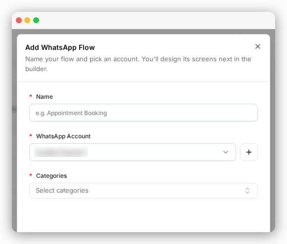
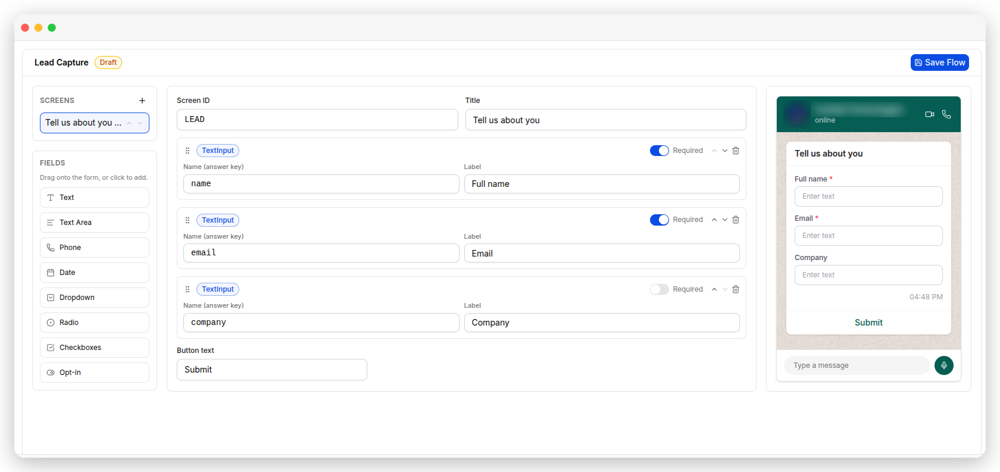
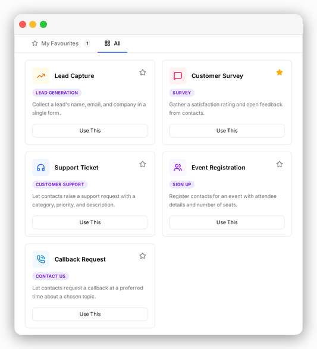
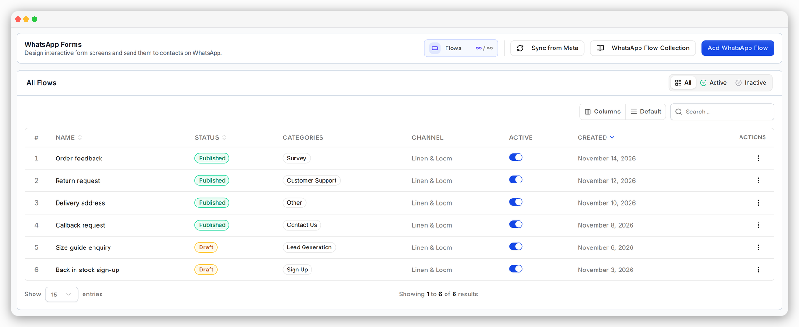
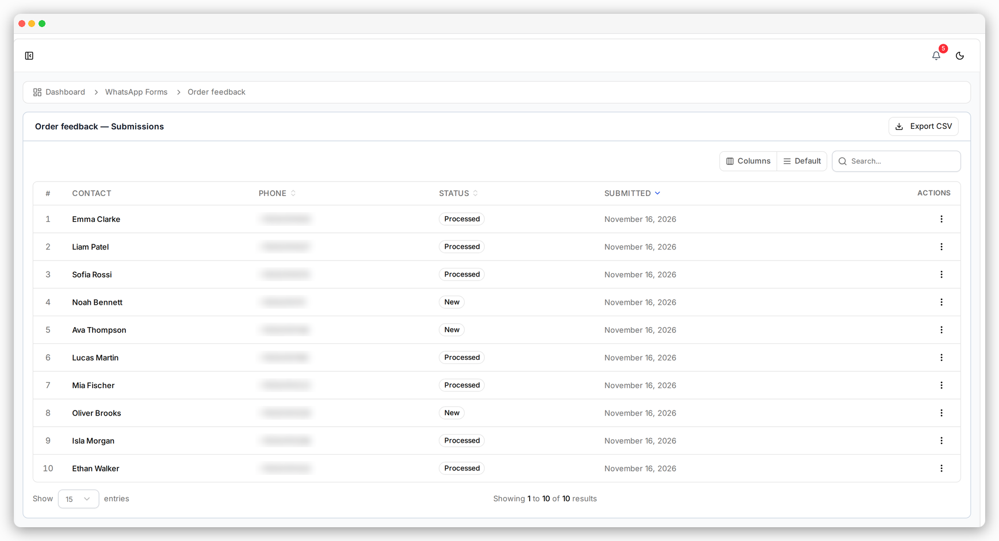

A WhatsApp Form is a form that opens inside a WhatsApp chat. Customers can fill in details, choose options, and submit the form without leaving WhatsApp. Use one to collect feedback, a delivery address, or a return request.

WhatsApp itself calls these **Flows**, so some buttons and screens in the app still say "flow".

## Building a form

<Steps>
<Step title="Create the form">
  Go to **WhatsApp Forms** in the sidebar. Click **Add WhatsApp Flow** and fill in the details.

  - **Name** — for your own reference.
  - **WhatsApp Account** — choose the WhatsApp number for this form.
  - **Categories** — select a category, such as Lead Generation or Survey. You cannot create a new category.

  
</Step>

<Step title="Design its screens">
  Click a form name to open the builder.

  The builder has three sections: the list of **form pages** on the left, the **page editor** in the middle, and a **phone preview** on the right.

  

  Drag a field to a form page to add it.

  - **Text** — A single-line text field.
  - **Text Area** — A multi-line text field.
  - **Phone** — A phone number field.
  - **Date** — A date picker.
  - **Dropdown** — Select one option from a list.
  - **Radio** — Select one option from a few options.
  - **Checkboxes** — Select one or more options.
  - **Opt-in** — A checkbox for customer consent.

Each field includes:

  - **Label** — The name shown to the customer, such as *Your name*.
  - **Name (answer key)** — A unique name used to identify the answer. You can see it later in [submissions](#submissions) and [field mapping](#field-mapping).
  - **Required** — Turn it on to make the field mandatory.

  Each form page has a button at the bottom. Continue opens the next page, and Submit finishes the form.
</Step>

<Step title="Publish">
  Click **Publish** to send the form to Meta for approval. If Meta returns any issues, the form will remain in Draft status. Click the form name to view the errors, fix the issues, and publish the form again.
</Step>
</Steps>

## Start from a ready-made form

You do not have to build from scratch. Click **WhatsApp Flow Collection** to see ready-made forms you can copy:

Select one and **Use This** copies it into your workspace as a draft you can change and publish.

## The forms list

The WhatsApp Forms page shows all your forms. Each form shows its **name**, **channel**, **status**, **category**, and an **Active** switch to turn it on or off.

| Action | What it does |
| --- | --- |
| **Flow Builder** | Open the builder to edit the form.|
| **View** | View the form details. |
| **Edit details** | Change the name, account, or categories. |
| **Mapping** | Save answers into contact records. See [Field mapping](#field-mapping). |
| **Submissions** | See who [submitted](#submissions) the form. |
| **Publish** | Publish the draft form. |
| **Deprecate** | Deprecate a published form. |
| **Duplicate** | Make a copy of the form. |
| **Delete** | Remove a draft form. |

## Form statuses

Every form shows a status so you know if it is ready to send.

| Status | It means |
| --- | --- |
| **Draft** | The form is not published yet. You can still edit it. |
| **Published** | The form is ready to use. |
| **Deprecated** | The form is no longer active, but its data is still available. |
| **Blocked** | Meta has blocked the form. |
| **Throttled** | Meta is temporarily limiting the form because of too many errors. |

## Field mapping

The answers people give in a form can go straight into your customer records. From the forms table `⋮` menu, choose **Mapping** to set it up.

For each field in the form, choose what to do with its answer:

- **Skip** — do not save it.
- **Contact field** — save it to a built-in contact field, like name or email.
- **Custom field** — save it to one of your [customer fields](/core-setup/custom-fields).
- **Tag** — add a [customer tag](/core-setup/labels) to the contact.

<Warning>
Set up mapping before you send the form. Answers only save to contacts once mapping is done — anything submitted before that is not added automatically.
</Warning>

## Sending a form

Once a form is published, there are two ways to send it to a customer.

- From a [contact's](/contacts/managing-contacts#actions-on-a-single-contact) row, choose **Send flow**.
- In the [Inbox](/messaging/live-chat), use the **Send form** button under the message box.

## Submissions

When a customer fills in the form and submits it, their answers are saved. A card with the answers also appears in the [Inbox](/messaging/live-chat).

From the forms table `⋮` menu, choose **Submissions** to see everyone who filled it in — their name, phone number, status, and the date. Click a row to read all of their answers, or use **Export** to download the list as a CSV file.

## What's next

<CardGroup cols={2}>
  <Card title="WhatsApp Flow step" icon="workflow" href="/automation/flow-steps/basic#whatsapp-flow">
    Add a form to an automation with the WhatsApp Flow step.
  </Card>

  <Card title="Automation" icon="bot" href="/automation/overview">
    Send a form automatically as part of a chatbot conversation.
  </Card>
</CardGroup>
