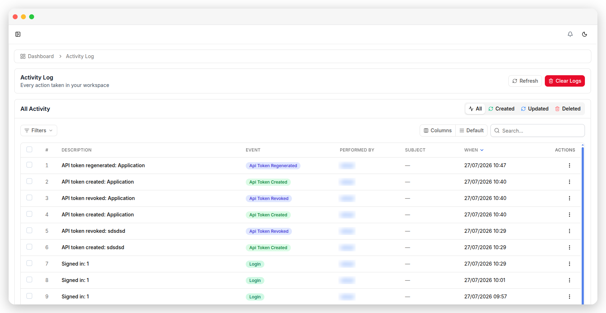

Want to know who edited a campaign or deleted a customer? The **Activity Log** shows what happened in your workspace, who did it, and when. Use it to review changes and keep track of your team's work.

## Activity log list

Each entry has:

- **Description** — Describes the action that was performed, such as "Signed in".
- **Event** — The type of action, such as **Member Added**.
- **Performed By** — The user who performed the action. If the action was performed automatically, **System** is shown.
- **Subject** — The item that was changed, such as a contact or campaign.
- **When** — When the action happened.

## Activities that are logged

You will find entries for things like:

- [Signing in](/getting-started/log-in) and out, and [password or two-factor](/settings/profile) changes. Opening your dashboard from Shopify shows as **Signed in from the Shopify admin**.
- [Team members](/core-setup/team-and-roles) added, edited or removed, and [role](/core-setup/roles-and-permissions) changes.
- [Customers](/contacts/managing-contacts) created, edited, deleted or [merged](/contacts/bulk-actions-and-merge).
- [Campaigns](/messaging/campaigns), [templates](/messaging/whatsapp-templates) and [channel](/core-setup/channels/whatsapp) changes.
- [Developer API keys](/core-setup/api-keys) created, regenerated or revoked.
- [Billing](/billing/plan-and-billing) changes, like a paid invoice.
- Someone trying to open a page their role does not allow.

<Note>
Some entries are protected and cannot be deleted — they show a shield instead of a checkbox. Protected entries stay even when you clear the log.
</Note>

Logs stay here until you delete them. They are not removed automatically.

## What's next

<CardGroup cols={2}>
  <Card title="WhatsApp Message Log" icon="list" href="/core-setup/whatsapp-activity-log">
    See every message sent out on your behalf.
  </Card>

  <Card title="Notifications" icon="bell" href="/reporting/notifications">
    Get told about important events as they happen.
  </Card>
</CardGroup>
