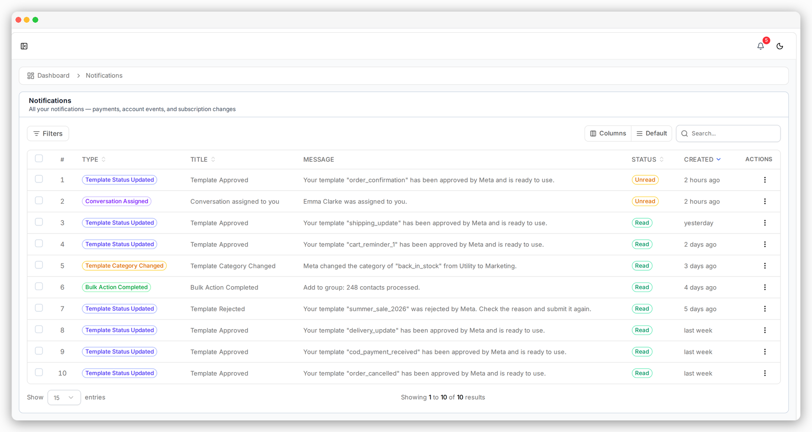

**Notifications** show important updates, such as approved templates, completed bulk actions, or account changes. A **red badge** shows how many notifications are unread. Click the **bell icon** to see recent notifications, or click **See all notifications** to view the full list.

<Note>
There is no Notifications link in the sidebar. Open the full page from the bell icon.
</Note>

## Notification types

- **Templates** — when Meta approves, rejects, pauses, disables or flags a [template](/messaging/whatsapp-templates), and when it changes a template's category.
- **Bulk actions** — When a bulk action has finished.
- **Your account** — When your account is created, activated, suspended, or put on hold.

## Managing notifications

On the **Notifications page**, use the `⋮` menu to **Mark as read** or **Delete** a notification. You can also select multiple notifications to perform these actions together.

Use **Filters** to show only read or unread ones, or a single type. The search box looks at the title and message.

## What's next

<CardGroup cols={2}>
  <Card title="Activity Log" icon="history" href="/reporting/activity-logs">
    See the full history behind any notification.
  </Card>

  <Card title="General Settings" icon="settings" href="/settings/general">
    Workspace name, timezone, and date format.
  </Card>
</CardGroup>
