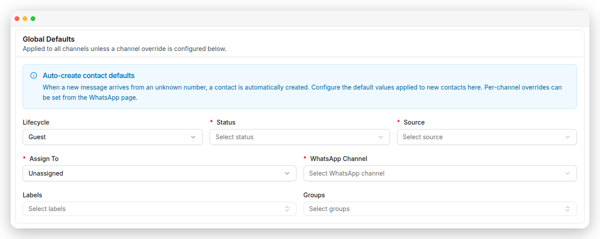

In **Settings → Customers**, you decide the default type, status, source, labels, groups, and assignee given to each new contact that's created automatically.

## Global Defaults

These apply to every new contact, whichever channel they come from.

- **Type** — what a new contact is called: **Guest**, **Lead** or **Customer**. See [Managing Contacts](/contacts/managing-contacts).
- **Status** — the [status](/core-setup/statuses) a new contact starts in, like *New*.
- **Source** — where the contact came from. See [Customer Sources](/core-setup/sources).
- **Assign To** — who handles the new contact. See [Ways to assign](#ways-to-assign).
- **Labels** — optional. Add one or more [customer tags](/core-setup/labels) to every new contact.
- **Groups** — optional. Put every new contact into one or more [customer groups](/core-setup/groups).

<Note>
Status, Source and Assign To are required. You cannot save until each one is filled in.
</Note>

### Ways to assign

- **Unassigned** — No one is assigned. Any team member can reply to the contact.
- **Round Robin** — New contacts are assigned to team members one by one.
- **Online Team Member** — Assigns the contact to a team member who is currently online. If no one is online, it assigns the contact to any team member.
- **Custom Team Member** — Assigns every new contact to the selected team member. Choose the team member from the list.

## Where these defaults are used

A contact is created with these settings whenever a new person reaches you, and not only through chat:

- A message on [WhatsApp](/core-setup/channels/whatsapp) or [Messenger](/core-setup/channels/messenger).
- An order from your [Shopify store](/shopify/shopify-admin-app).

## What's next

<CardGroup cols={2}>
  <Card title="Customer Statuses" icon="circle" href="/core-setup/statuses">
    Track where every contact stands in your sales journey.
  </Card>

  <Card title="Managing Contacts" icon="contact" href="/contacts/managing-contacts">
    Browse, create, and edit contacts individually.
  </Card>
</CardGroup>
