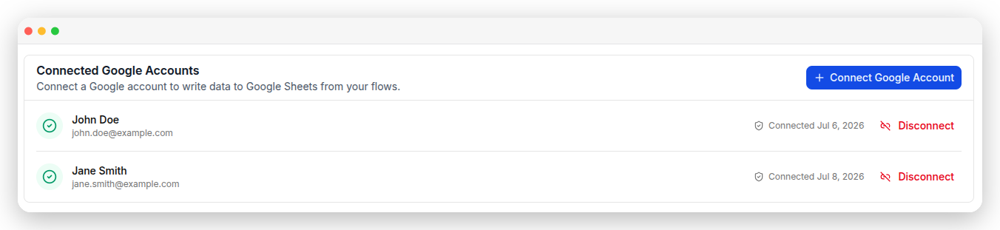

Connect your Google account once, and ChatFlows can use it in two ways:

- **Google Sheets** — when a customer answers a question in an [automation](/automation/overview), the flow can add their details as a new row in a Google Sheet.
- **Google Calendar** — an automation can create an event in your Google Calendar.

Find it under **Settings → Google Accounts**.

## Connecting an account

<Steps>
<Step title="Click Connect Google Account">
  You are taken to Google's own sign-in page.
</Step>

<Step title="Sign in and allow access">
  Pick the Google account you want to connect and approve the permissions it asks for — access to your Google Sheets and Google Calendar, plus read-only access to your Drive file list so you can pick a sheet.
</Step>

<Step title="Check it worked">
  You come back to this page and the account is listed with its name, email address and the date you connected it.
</Step>
</Steps>

<Note>
You can connect more than one Google account. You pick which one to use on the Google Sheets or Calendar Event step when you build a [flow](/automation/flow-builder).
</Note>

## Disconnecting

Click **Disconnect** next to an account to remove it. You'll be asked to confirm first, since any flow using that account will stop working.

## What's next

<CardGroup cols={2}>
  <Card title="Automation Flows" icon="bot" href="/automation/overview">
    Add a row to a Google Sheet from a flow.
  </Card>

  <Card title="Integration steps" icon="calendar-check" href="/automation/flow-steps/integrations">
    Use the Google Sheets and Calendar Event steps in a flow.
  </Card>
</CardGroup>
