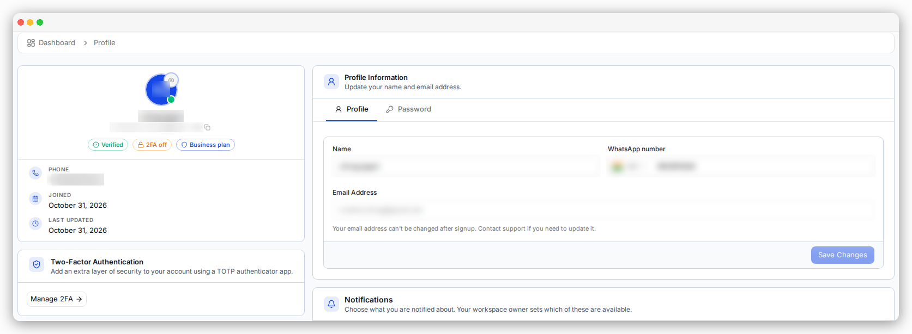
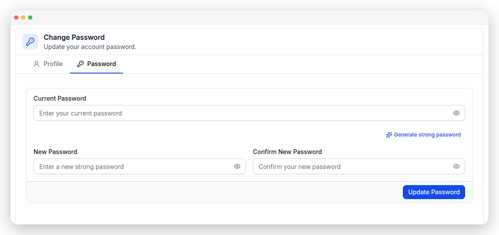
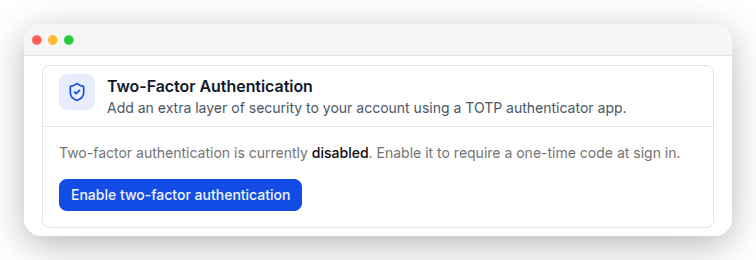
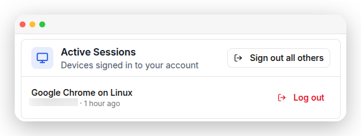
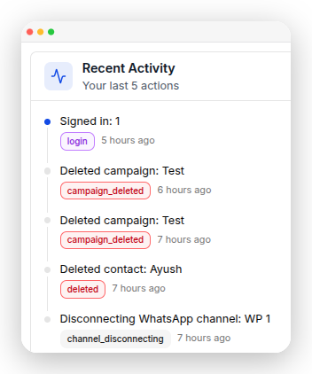

Your profile settings apply only to your account and don't affect anyone else in your workspace. To open them, click your name at the bottom of the sidebar, then **My Profile**.

Here you'll find **Profile** and **Password** tabs, plus **Two-Factor Authentication**, **Active Sessions**, and **Recent Activity**.

## Your details

On the **Profile** tab:

- **Name** — Your display name. Required.
- **WhatsApp number** — your own WhatsApp number.
- **Email Address** — Your email address. You can't change it yourself.
- **Photo** — Click the **camera** icon to upload a photo or pick one from the [Media Library](/media/media-library). Use a JPEG, PNG, or WebP file up to **5 MB**. Click **Remove photo** to go back to your initials.

<Warning>
If you change your WhatsApp number, we send a 6-digit code to the new number. Your number only updates once you enter that code to confirm it.
</Warning>

## Changing your password

On the **Password** tab:

- **Current Password** — Enter your current password. This field is hidden if you signed in with Google, since you don't have one.
- **New Password** and **Confirm New Password** — Enter your new password in both fields. Or click **Generate strong password**, then **Use this password** to fill them for you.
- Click **Update Password** to save.

## Two-factor authentication

Two-factor authentication adds an extra layer of security. After your password, you also enter a code from your phone — so your account stays safe even if someone knows your password.

Click **Manage 2FA** to turn it on or off.

<Steps>
<Step title="Confirm your password">
  Enter your password to confirm it's you before making changes.
</Step>

<Step title="Scan the QR code">
  Open an authenticator app, such as **Google Authenticator**, and scan the QR code. If you can't scan it, enter the setup key instead. Then click **Continue**.
</Step>

<Step title="Enter the 6-digit code">
  Your authenticator app shows a 6-digit code. Type it in and click **Confirm**.
</Step>

<Step title="Save your recovery codes">
  Click **View Recovery Codes** and save them somewhere safe. If you ever lose your phone, these codes let you sign in — each one works only once.
</Step>
</Steps>

## Active sessions

All the devices you're signed in on are listed here. For each one, you can see the **browser, operating system, IP address, and last active time**. Your current device is marked as **This device**.

- Click **Log out** to sign out a specific device. You can't sign out the device you're currently using.
- Click **Sign out all others** to sign out every other device. This option only appears if you're signed in on more than one device.

## Recent activity

This shows the last 5 actions you took in the workspace. To see your full history and what your team has been doing, open the [Activity Log](/reporting/activity-logs).

## What's next

<CardGroup cols={2}>
  <Card title="Login & Security" icon="log-in" href="/getting-started/log-in">
    Signing in, and what to do if you forget your password.
  </Card>

  <Card title="Team & Agents" icon="users" href="/core-setup/team-and-roles">
    Manage who else can get into your workspace.
  </Card>
</CardGroup>
