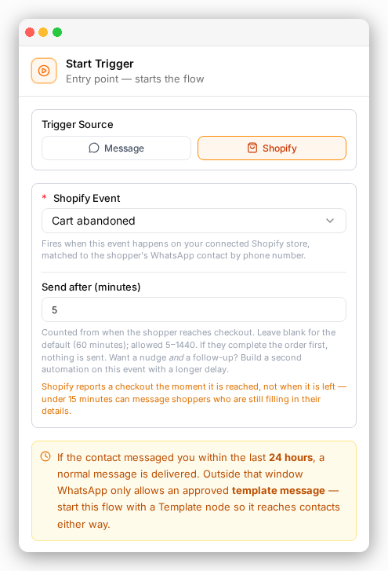
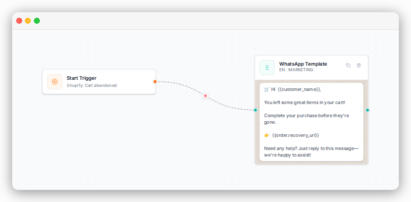

Some shoppers reach your checkout and leave without paying.
ChatFlows.io can send them a WhatsApp message with a link back to their cart.

## How it works

1. A shopper reaches your checkout and leaves without paying.
2. ChatFlows.io waits for the time you set.
3. If they still haven't paid, your automation sends the message.
4. If they pay before then, nothing is sent.

Only one message goes out per cart for each automation.

## Before you start

- Your [store is connected](/shopify/connect-your-store).
- Your [WhatsApp number is connected](/core-setup/channels/whatsapp).
- You have an **approved** [WhatsApp template](/messaging/whatsapp-templates) for the reminder.

<Note>
  The shopper hasn't messaged you, so the first message must be an approved template.
  This is a WhatsApp rule, not a ChatFlows.io one. See [the 24-hour rule](/getting-started/concepts).
</Note>

## Build the automation

<Steps>
  <Step title="Create an automation" icon="plus">
    Go to **Automations** and create a new automation.
  </Step>

  <Step title="Set the trigger" icon="play">
    Click the **Start Trigger**. Choose **Shopify** as the trigger source, then **Cart abandoned** as the event.
  </Step>

  <Step title="Choose when to send" icon="clock">
    In **Send after (minutes)**, enter how long to wait. You can enter 5 to 1,440 minutes (24 hours).
    Leave it empty to use 60 minutes.
  
    
  </Step>

  <Step title="Add your template" icon="file-text">
    Add a [**WhatsApp Template**](/automation/flow-steps/basic#whatsapp-template) step and pick your approved reminder.
  </Step>

  <Step title="Add the cart link" icon="link">
    Put `order.recovery_url` in the template's button or text. It takes the shopper back to checkout with their cart still full.
  </Step>

  <Step title="Save and turn it on" icon="check">
    Save the automation. It runs for every new abandoned cart from now on.
  </Step>
</Steps>

## Choosing the wait time

Shopify tells ChatFlows.io about a checkout as soon as the shopper **reaches** it, not when they leave.
A very short wait can message someone who is still typing their address.

- Under 15 minutes is usually too soon.
- 30 to 60 minutes works well for most stores.

## Send two reminders

You can send more than one reminder. Make one automation for each reminder, each with its own wait time.

For example:

- Automation 1: **Cart abandoned**, send after **20** minutes. A friendly nudge.
- Automation 2: **Cart abandoned**, send after **720** minutes (12 hours). A last reminder.

If the shopper pays after the first reminder, the second one is not sent.

<Tip>
  Each reminder is a template message. WhatsApp charges for each one. Two reminders are usually enough.
</Tip>

## See your results

The [Shopify dashboard](/shopify/shopify-dashboard) shows how many carts were abandoned, how many were recovered, and how many got a reminder.

## Where to next

<CardGroup cols={2}>
  <Card title="Send order updates" icon="package" href="/shopify/order-updates">
    Message customers when an order is placed, shipped or delivered.
  </Card>

  <Card title="Order details in your messages" icon="braces" href="/messaging/merge-fields">
    Add the cart total, items and more to your reminder.
  </Card>
</CardGroup>
