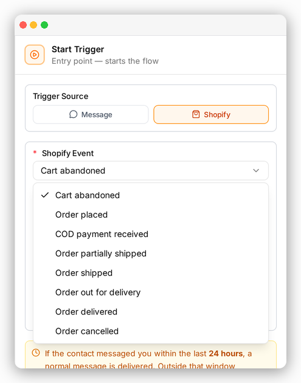

Keep customers updated about their order on WhatsApp. Fewer people will ask "Where is my order?"

Each update is an automation. It starts by itself when something happens to an order in your store.

## Order events you can use

| Event | When it runs |
| --- | --- |
| **Order placed** | A new order is placed. |
| **COD order placed** | A cash-on-delivery order is placed, before the buyer pays. Use it to ask the buyer to confirm. See [COD orders](/shopify/cod-orders). |
| **COD payment received** | A cash-on-delivery order is marked as paid in Shopify. It runs after payment, not before the order ships. |
| **Order partially shipped** | Part of the order has shipped. |
| **Order shipped** | The whole order has shipped. |
| **Order out for delivery** | The courier is delivering it today. |
| **Order delivered** | The order reached the customer. |
| **Order cancelled** | The order was cancelled. |

The same list also has **Cart abandoned**, for customers who leave checkout. See [Recover abandoned carts](/shopify/cart-recovery).

Need wording for these messages? [Template examples](/messaging/template-examples#utility-templates) has a ready-to-use message for each update.

### Out for delivery and Delivered need tracking

<Warning>
  **Order out for delivery** and **Order delivered** only run when your shipping carrier or shipping app sends tracking updates to Shopify.
  If you mark orders as fulfilled by hand, these two events never run.
</Warning>

Whether you get these updates depends on your carrier and how you ship, not on ChatFlows. Shopify explains it under [order status pages](https://help.shopify.com/en/manual/fulfillment/setup/order-status-page/understanding-order-status-pages).

**To check your store:**

1. Open a shipped order in your Shopify admin.
2. Look at its tracking. If it shows steps such as **Out for delivery** or **Delivered**, these two events will run.
3. If it doesn't, ask your shipping app or carrier whether they send tracking updates to Shopify.

No tracking updates? Use **Order shipped** and add the tracking link to the message. Your customers can follow the delivery themselves.

Selling with cash on delivery? See [COD orders](/shopify/cod-orders).

## Before you start

- Your [store is connected](/shopify/shopify-admin-app).
- Your [WhatsApp number is connected](/core-setup/channels/whatsapp).
- You have an **approved** [WhatsApp template](/messaging/whatsapp-templates) for each update.
  Order updates usually fit the **Utility** category.

## Build an order update

<Steps>
  <Step title="Create an automation" icon="plus">
    Go to **Automations** and create a new automation.
  </Step>

  <Step title="Set the trigger" icon="play">
    Click the **Start Trigger**. Choose **Shopify** as the trigger source, then pick the event, for example **Order shipped**.
  </Step>

  <Step title="Add your template" icon="file-text">
    Add a [**WhatsApp Template**](/automation/flow-steps/basic#whatsapp-template) step and pick your approved message.
    Add order details like the order number or tracking link. Type `@` to pick them.
    See [merge fields](/messaging/merge-fields) for the full list.
  </Step>

  <Step title="Save and turn it on" icon="check">
    Save the automation. It runs for every matching order from now on.
  </Step>
</Steps>

Make one automation for each event you want to use.

## Ask for feedback after delivery

1. Make an automation with the **Order delivered** event.
2. Add a [**Delay**](/automation/flow-steps/advanced) step, for example 2 days.
3. Add a template that asks how the order went.

## How ChatFlows finds the customer

ChatFlows uses the phone number on the order to find the customer.
If there is no customer with that number yet, one is created.
Orders without a phone number don't get a message.

## Common questions

<AccordionGroup>
  <Accordion title="Can I send Shopify order updates by SMS or email instead of WhatsApp?">
    No. ChatFlows sends Shopify order updates on WhatsApp only, from your connected WhatsApp number. Customers are matched by the phone number on the order.
  </Accordion>

  <Accordion title="Does ChatFlows change or cancel my orders in Shopify?">
    ChatFlows never changes products. It changes or cancels an order only when you add an **Update Shopify Order** or **Cancel Shopify Order** step to an automation, such as the ready-made COD verification. See [COD orders](/shopify/cod-orders).
  </Accordion>

  <Accordion title="Do I need to change my Shopify theme to send order updates?">
    No. ChatFlows doesn't add anything to your storefront or theme. Order events reach ChatFlows from Shopify itself.
  </Accordion>

  <Accordion title="Can I message a customer who has never contacted me on WhatsApp?">
    Yes, with an approved template. WhatsApp requires the first message to a customer to be an approved template, and that is Meta's rule, not ChatFlows'.
    See [Meta's template rules](https://developers.facebook.com/documentation/business-messaging/whatsapp/templates/overview).
  </Accordion>
</AccordionGroup>

## Where to next

<CardGroup cols={2}>
  <Card title="Template examples" icon="file-text" href="/messaging/template-examples">
    Copy-ready wording for every order update.
  </Card>

  <Card title="Your Shopify dashboard" icon="chart-line" href="/shopify/shopify-dashboard">
    See how many messages were sent, delivered and read for each event.
  </Card>

  <Card title="Recover abandoned carts" icon="shopping-cart" href="/shopify/cart-recovery">
    Remind customers who left without paying.
  </Card>
</CardGroup>
