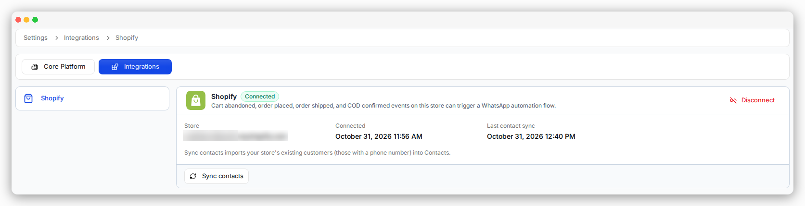

Your store is connected for you when you [install ChatFlows from Shopify](/getting-started/install-from-shopify).
After that, you can see your store in two places:

- **The ChatFlows app in your Shopify admin** shows your store's status and sales, and opens your dashboard in one click.
- **Settings → Shopify in your workspace** is where you sync your customers and disconnect the store.

You do your real work in the ChatFlows dashboard.

## Find the app

In your Shopify admin, click **ChatFlows** under **Apps** in the left menu.
The app has two pages in the menu: **Overview** and **Plan & billing**.

At the top right of every page:

- **Need help?** opens these docs in a new tab.
- **Get support** opens your support portal in a new tab, already signed in, so you can open a ticket.

## Overview

This is the page you see first. At the top it shows your store, its connection status, your workspace, your plan and the next billing date.
**Open dashboard** opens your workspace in a new tab.

### Getting started checklist

Until your setup is finished, Overview shows a **Getting started** checklist with five steps:

1. **Store connected** — done for you when you install the app.
2. **Connect your WhatsApp number** — ticks itself once a number is connected.
3. **Add your message templates** — add the ready-made order and cart messages from the library, or use your own. Click **Mark as done** when your templates are ready.
4. **Turn on automations for store events** — ticks itself once a Shopify automation is switched on.
5. **Send a test order** — click **Create test order** to place an order in your Shopify admin with your own WhatsApp number, then check that the message arrives on your phone. It ticks itself when the message is delivered, or you can click **Mark as done**.

The next step to do is marked **Next**. Each open step has a button that takes you straight to the right page.
A step you marked done yourself shows **Marked done**, and you can click **Undo**.

### Your store's numbers

Once every step is done, Overview shows your store's numbers instead:

- **Orders**, **Revenue**, **Average order value** and **Carts recovered**.
- One chart with three tabs: orders, cart recovery, and automations.

You can see the last 7, 30 or 90 days. These numbers match the [Shopify dashboard](/shopify/shopify-dashboard) in ChatFlows.

If something needs your attention, a notice tells you what to do.
Enjoying ChatFlows? Click **Leave a review** to rate the app on the Shopify App Store.

## Setup

Setup is not in the menu. It opens from a notice on Overview when your store's connection or permissions need attention.
It shows how your store is connected and the same **Getting started** checklist.

- **Store connection** shows your store, your workspace, and when it was connected.
- **Permissions** shows what ChatFlows may access in your store: **Orders and checkouts**, **Delivery updates**, and **Order changes** (the tags, holds and cancellations your COD automation makes, see [COD orders](/shopify/cod-orders)). Each one shows **Granted** when it's on.
- **In your workspace** has shortcuts to **WhatsApp setup** and **Automations**.

If something is wrong:

- If the connection has a problem, you see the reason. Click **Reconnect** to connect through Shopify again.
- **Retry setup** opens the Shopify page in your dashboard to finish the setup.
- If you see **Delivery updates are off**, your store was connected before ChatFlows asked for delivery access.
  The **Order out for delivery** and **Order delivered** automations can't run.
  Reconnect the store once to turn them on.
- If you see **Order changes are off**, your store was connected before ChatFlows asked to update orders.
  Automations can't tag, hold or cancel orders, so COD verification can't mark orders as confirmed.
  Reconnect the store once to turn it on.

## Plan & billing

This page shows your **Current plan** with its price, your **Next charge**, and that you are **Billed through** Shopify. Your invoice is your Shopify bill, under **Settings → Billing → Bills** in your Shopify admin.
Under **Change plan**, switch between **Monthly** and **Yearly** and move to another plan with **Upgrade** or **Downgrade**.

See [Plan and billing](/billing/plan-and-billing) for the details.

## Open your dashboard

Click **Open dashboard** to go to ChatFlows. It opens in a new tab and you are signed in as the workspace owner. You don't need a password.

<Note>
  Anyone who can open ChatFlows in your Shopify admin can use **Open dashboard**.
  Give app access in Shopify only to staff you trust.
</Note>

If you have not set a password yet, your dashboard shows **Set a password so you can also sign in directly, without going through Shopify.**
You don't have to do it. A password lets you sign in from any browser without opening Shopify first.

## Your store in your workspace

In your workspace, go to **Settings → Shopify**. The store card shows one of these:

- **Connected** — everything works. Store events can start your automations.
- **Connecting…** — setup is still finishing. It changes to **Connected** a moment later.
- **Needs attention** — something stopped working. The card shows the reason Shopify gave. Click **Reconnect** to approve ChatFlows again in Shopify, or **Retry setup** to run the setup again.

<Note>
  Customers can only get WhatsApp messages if your Shopify checkout asks for a phone number.
</Note>

## Bring in your Shopify customers

On **Settings → Shopify**, click **Sync contacts** to bring the customers already in your store into [Customers](/contacts/managing-contacts).

Only customers **with a phone number** are brought in. The rest are skipped.
If a customer has tags in Shopify, they come across as customer tags.

## Disconnect your store

On **Settings → Shopify**, click **Disconnect** and confirm. Shopify events stop starting your automations right away.
Uninstalling ChatFlows from your Shopify admin also disconnects the store and cancels your plan.

Your customers stay in your workspace, and your automations are not deleted.
If you connect the store again later, your automations work again.

## Common questions

<AccordionGroup>
  <Accordion title="Does ChatFlows change my Shopify products, orders or settings?">
    ChatFlows never changes your products or settings. It changes an order (tags, notes, a hold or a cancellation) only when one of your automations does it, for example tagging it **COD-CONFIRMED**.
    See [Setup](#setup).
  </Accordion>

  <Accordion title="Do I need to change my Shopify theme to use ChatFlows?">
    No. ChatFlows doesn't add anything to your storefront or theme.
  </Accordion>

  <Accordion title="Can I open ChatFlows without going through my Shopify admin?">
    Yes, once you set a password. Your dashboard offers **Set a password**, so you can sign in from any browser.
    See [Open your dashboard](#open-your-dashboard).
  </Accordion>
</AccordionGroup>

## Where to next

<CardGroup cols={2}>
  <Card title="Send order updates" icon="package" href="/shopify/order-updates">
    Tell buyers when their order is placed, shipped, out for delivery or delivered.
  </Card>

  <Card title="Recover abandoned carts" icon="shopping-cart" href="/shopify/cart-recovery">
    Build your first Shopify automation.
  </Card>
</CardGroup>
