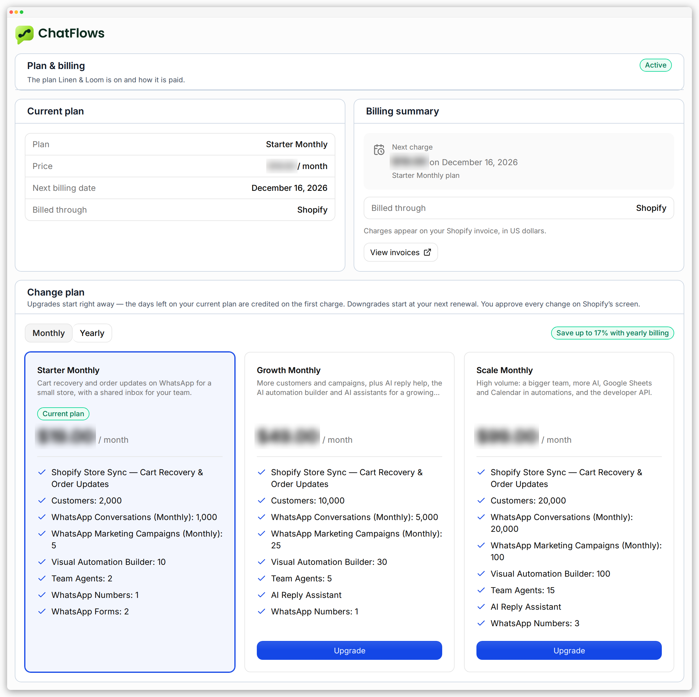

ChatFlows.io has a small app inside your Shopify admin. It shows how your store is doing and whether everything is connected.
You do your real work in the ChatFlows.io dashboard. The app opens it for you in one click.

## Find the app

In your Shopify admin, click **ChatFlows.io** under **Apps** in the left menu.
The app has three pages: **Overview**, **Setup** and **Plan & billing**.

## Overview

This is the page you see first. It shows:

- Your store, its connection status, and your workspace.
- Your plan, its status, and the next billing date.
- **Orders**, **Revenue**, **Average order value** and **Carts recovered**.
- One chart with three tabs: orders, cart recovery, and automations.

You can see the last 7, 30 or 90 days. These numbers match the [Shopify dashboard](/shopify/shopify-dashboard) in ChatFlows.io.

If something needs your attention, a notice tells you what to do.

## Setup

This page shows how your store is connected and what is left to set up.

- **Store connection** shows your store, your workspace, when it was connected, and which Shopify app it uses.
- **Permissions** shows what ChatFlows.io may read from your store: **Orders and checkouts**, and **Delivery updates**. Each one shows **Granted** when it's on.

If something is wrong:

- If the connection has a problem, you see the reason. Click **Reconnect** to connect through Shopify again.
- **Retry setup** opens the Shopify page in your dashboard to finish the setup.
- If you see **Delivery updates are off**, your store was connected before ChatFlows.io asked for delivery access.
  The **Order out for delivery** and **Order delivered** automations can't run.
  Reconnect the store once to turn them on.

The **Quick start** has three steps: **Workspace ready**, **Connect WhatsApp**, and **Build a Shopify automation**.
Click **Set up** on a step to open that page in your dashboard. **In your workspace** has shortcuts to **WhatsApp setup** and **Automations**.

## Plan & billing

This page shows your **Current plan** and a **Billing summary** with the next charge, and a **View invoices** link.
Under **Change plan**, you can move to another plan.

See [Plan and billing](/billing/plan-and-billing) for the details.

## Open your dashboard

Click **Open dashboard** to go to ChatFlows.io. You are signed in as the workspace owner. You don't need a password.

<Note>
  Anyone who can open ChatFlows.io in your Shopify admin can use **Open dashboard**.
  Give app access in Shopify only to staff you trust.
</Note>

If you have not set a password yet, your dashboard shows **Set a password to sign in without Shopify**.
You don't have to do it. A password lets you sign in from any browser without opening Shopify first.

## Where to next

<CardGroup cols={2}>
  <Card title="Connect your store" icon="plug" href="/shopify/connect-your-store">
    How the connection works, and how to fix it.
  </Card>

  <Card title="Recover abandoned carts" icon="shopping-cart" href="/shopify/cart-recovery">
    Build your first Shopify automation.
  </Card>
</CardGroup>
