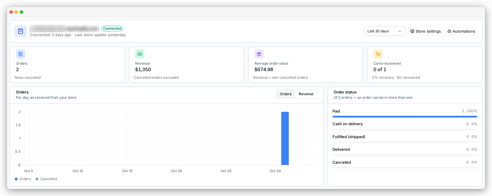
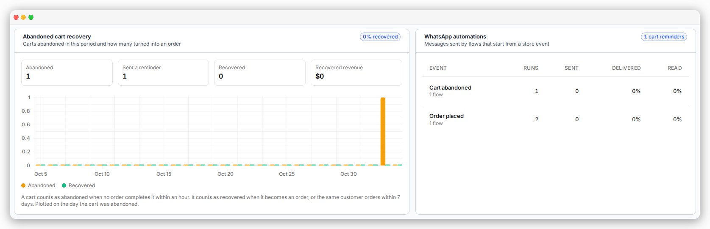

The top of your **Dashboard** shows how your Shopify store is doing.
You can see your sales, your recovered carts, and what your WhatsApp automations sent.

## Pick a date range

Choose the last **7**, **14**, **30** or **90** days, or the last **year**. The default is 30 days.

## Sales

- **Orders** — how many orders were placed.
- **Revenue** — the total value of orders that were not cancelled.
- **Average order value** — revenue divided by the number of orders.
- **Order status** — how many orders are Paid, COD, Fulfilled, Delivered or Cancelled.
  One order can be in more than one group. A COD order can also be Delivered, for example.

<Note>
  Only orders placed **after** you connected your store are counted.
  If your store uses more than one currency, revenue uses the currency of most orders.
  Orders in other currencies are counted, but their value is not added.
</Note>

## Abandoned cart recovery

- **Abandoned** — carts where the shopper reached checkout and left without paying.
- **Recovered** — abandoned carts that later became an order.
- **Sent a reminder** — abandoned carts that got a WhatsApp reminder.

A cart counts as recovered when the same checkout is paid, or the same customer orders within 7 days.
The order must not be cancelled.

A cart recovered after a reminder doesn't always mean the reminder caused the sale. The shopper might have come back anyway.

## WhatsApp automations

This table shows each store event, like **Cart abandoned** or **Order shipped**. For each one you see:

- **Runs** — how many times the automations started.
- **Sent**, **Delivered** and **Read** — what happened to the messages they sent.

The **Read** number can be lower than the real number. Some customers turn off read receipts in WhatsApp.

## No store connected yet

You see a **Connect your Shopify store** card instead. See [Connect your store](/shopify/connect-your-store).

## Where to next

<CardGroup cols={2}>
  <Card title="Recover abandoned carts" icon="shopping-cart" href="/shopify/cart-recovery">
    Set up the reminders that feed these numbers.
  </Card>

  <Card title="Dashboard & usage" icon="gauge" href="/reporting/dashboard-and-usage">
    The rest of your dashboard: usage, campaigns and charts.
  </Card>
</CardGroup>
