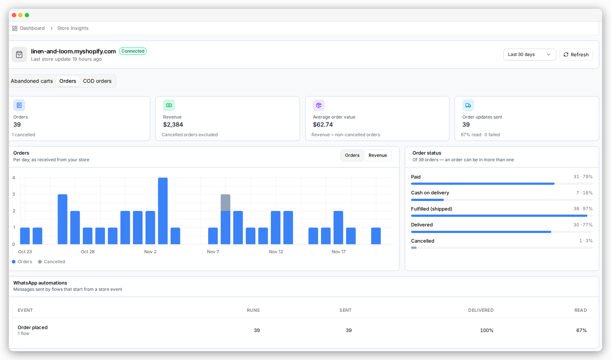
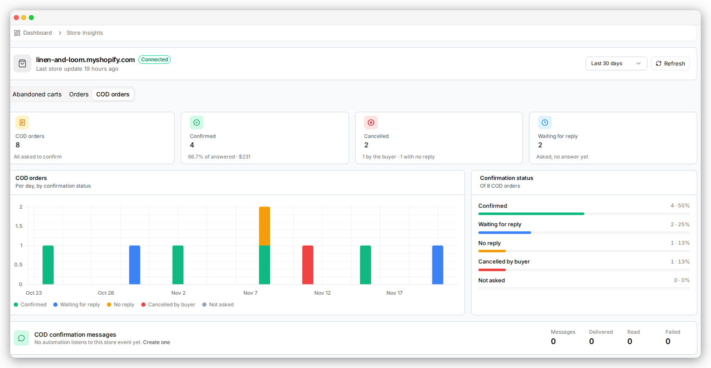
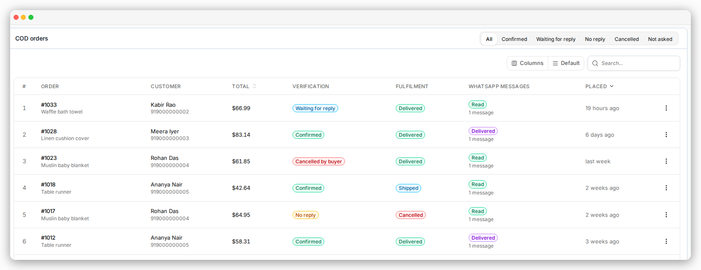

**Store Insights** shows the customers behind your Shopify numbers.
For each abandoned cart, order and cash-on-delivery (COD) order, you see who it was, what they bought, and which WhatsApp messages your automations sent them.
From the same list, you can send a customer a template or open their chat.

## Open Store Insights

In your dashboard, click **Store Insights** in the left menu.

The page has three tabs: **Abandoned carts**, **Orders** and **COD orders**.
Each tab shows summary cards and charts at the top, and a customer list below.

<Note>
  You see Store Insights when your plan includes the Shopify integration and your role can view customers.
  If no store is connected yet, the page shows a **Connect Shopify** button instead.
</Note>

## Pick a date range

At the top right, choose **Last 7 days**, **Last 14 days**, **Last 30 days**, **Last 90 days** or **Last year**. The default is 30 days.
Click **Refresh** to load the newest numbers.

The numbers match the [Shopify dashboard](/shopify/shopify-dashboard) for the same date range.

## Abandoned carts

- **Abandoned carts** — shoppers who reached checkout and left without ordering for an hour.
- **Reminded on WhatsApp** — abandoned carts that got a WhatsApp reminder.
- **Carts recovered** — abandoned carts that later became an order, and how many of those came after a reminder.
- **Recovered revenue** — the value of those orders, placed within 7 days of the abandoned cart.

The **Recovery funnel** shows how many carts moved from abandoned, to reminded, to recovered.
**Cart reminders on WhatsApp** shows how many reminder messages were sent, delivered, read and failed.

The list below shows each cart: the customer, the products, the cart value, when it was abandoned, its status, the WhatsApp messages it got, and the order it turned into.
Use the filters to see **Recovered**, **Reminded, not recovered**, **Not reminded** or **No phone** carts.

## Orders

- **Orders**, **Revenue** and **Average order value** — the same figures as your Shopify dashboard. Cancelled orders are not counted in revenue.
- **Order updates sent** — how many WhatsApp order updates your automations sent, and how many were read.
- **Order status** — how many orders are paid, cash on delivery, shipped, delivered or cancelled. One order can be in more than one group.
- **WhatsApp automations** — for each store event, how many times your automations ran and what happened to their messages.

The list below shows each order with its number, products, customer, total, payment (**Prepaid** or **COD**), fulfilment, and the WhatsApp messages it got.
Use the filters to see **Not shipped**, **Shipped**, **Delivered** or **Cancelled** orders.
The **All payments** menu shows only **COD** or **Prepaid** orders, and the **Messaged or not** menu shows only orders that **Got a WhatsApp update** or had **No WhatsApp update**.

## COD orders

This tab shows how your [COD verification](/shopify/cod-orders) is going.

- **COD orders** — cash-on-delivery orders in the date range, and how many were asked to confirm.
- **Confirmed** — orders the buyer confirmed, as a share of the ones they answered, with their value.
- **Cancelled** — orders the buyer cancelled, or that got no reply.
- **Waiting for reply** — orders that were asked to confirm and have no answer yet.

The status comes from the tags your COD automation puts on the order in Shopify: **COD-CONFIRMED**, **COD-CANCELLED**, **COD-NO-REPLY** and **COD-PENDING**.
An order with none of these tags shows as **Not asked**.

The list below shows each COD order with its verification status, fulfilment and WhatsApp messages.
Use the filters to see **Confirmed**, **Waiting for reply**, **No reply**, **Cancelled** or **Not asked** orders.

## Follow up with a customer

Click **⋮** at the end of a row to:

- **Send template** — send the customer an approved WhatsApp template, for example a reminder or an offer.
- **Open chat** — open the customer's conversation in the [Inbox](/messaging/live-chat).
- **Copy recovery link** — copy the link that takes the shopper back to their cart (abandoned carts only).
- **View in Shopify** — open the order in your Shopify admin (orders only).

**Send template** needs a phone number. **Open chat** needs an existing conversation with the customer. Both also need your role to allow starting chats or sending templates.

You can also search the list by name, phone or order number, and choose which columns to show with **Columns**.

## Common questions

<AccordionGroup>
  <Accordion title="Why does a cart show No phone?">
    The shopper didn't give a phone number at checkout, so no WhatsApp message can be sent.
    Make the phone number required in your Shopify checkout settings to reach more shoppers.
  </Accordion>

  <Accordion title="When does a cart count as recovered?">
    When the same checkout becomes an order, or the same customer places an order within 7 days of leaving the cart.
  </Accordion>

  <Accordion title="Why is the Read number lower than Delivered?">
    Some customers turn off read receipts in WhatsApp, so the real number of reads can be higher.
  </Accordion>
</AccordionGroup>

## Where to next

<CardGroup cols={2}>
  <Card title="Recover abandoned carts" icon="shopping-cart" href="/shopify/cart-recovery">
    Set up the reminders that bring shoppers back.
  </Card>

  <Card title="Verify COD orders" icon="badge-check" href="/shopify/cod-orders">
    Ask COD buyers to confirm before you ship.
  </Card>
</CardGroup>
